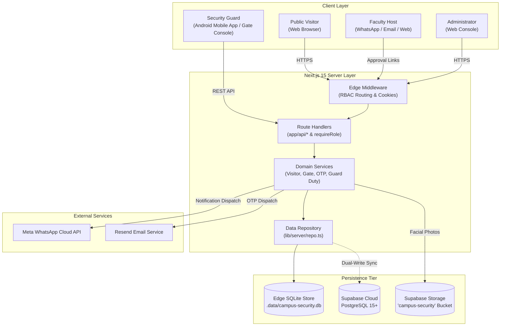

# Campus Security Management System (CSMS)
### Dev Sanskriti Vishwavidyalaya (DSVV), Haridwar

[](https://nextjs.org/)
[](https://react.dev/)
[](https://www.typescriptlang.org/)
[](https://tailwindcss.com/)
[](https://supabase.com/)
[](https://reactnative.dev/)
[](https://expo.dev/)
[]()
[]()

---

## 1. Project Overview

The **Campus Security Management System (CSMS)** is an enterprise-grade campus access control, visitor pre-booking, gate security verification, and guard operations platform built specifically for **Dev Sanskriti Vishwavidyalaya (DSVV), Haridwar**.

CSMS unifies five critical campus operational surfaces into a single, cohesive architecture:
1. **Public Visitor Portal:** Online visitor pre-registration, live facial photograph capture, vehicle registration, and instant QR pass issuance.
2. **Faculty Host Approval System:** Automated WhatsApp and Email notifications with cryptographic single-use approval links for meeting authorization.
3. **Security Guard Console & Dedicated Mobile App:** Handheld QR barcode scanning, gate entry (IN) and exit (OUT) logging, visitor badge assignment, and SOS distress dispatch.
4. **Guard Duty & Shift Handover Management:** Shift scheduling, post staffing compliance, physical equipment checklists, and perimeter patrol logging.
5. **Administrative & Super Admin Dashboard:** Real-time gate occupancy monitoring, comprehensive visitor analytics, department reports, security incident investigations, and audit trails.

---

## 2. Project Objectives

* **Zero-Trust Gate Operations:** The QR code pass acts only as an opaque pointer; the server alone verifies validity, arrival date, visiting hours, and facial photograph before authorizing entry.
* **Streamlined Visitor Experience:** Elimination of physical logbooks and paper gate passes, replacing them with digital passes sent directly to visitors via WhatsApp.
* **Elimination of Host Delays:** Faculty members approve or deny visitor meetings directly from WhatsApp or Email with a single tap, without logging into a complex software system.
* **Physical & Digital Audit Trails:** Complete chronological accountability for every gate crossing, vehicle entry, guard shift handover, and security incident.
* **High Availability & Offline Resilience:** Dual-store persistence combining a high-performance local SQLite engine (WAL mode) with Supabase Cloud PostgreSQL.

---

## 3. Main Features

* **Progressive Visitor Booking Wizard:** 4-section form with real-time validation, dynamic category-based faculty selection, and accompanying guest counter.
* **Live Webcam Identification:** Browser-based and mobile-based facial photo capture stored securely in private cloud storage.
* **Cryptographic QR Passes:** Single-use, time-bound, 32-character opaque tokens containing zero Personally Identifiable Information (PII).
* **Two-Way Gate State Machine:** Enforces atomic transitions (`APPROVED` → `CHECKED_IN` → `CHECKED_OUT`) and actively prevents duplicate entry attempts.
* **Faculty WhatsApp & Email Webhooks:** Meta Cloud Graph API v21.0 integration with HMAC-SHA256 signature verification and single-use approval links.
* **Guard Shift Sessions & Handover Checklists:** Digital logbook tracking shift start/end times, visitor metrics, open incidents, and physical equipment condition.
* **Perimeter Patrol Logging:** Guard patrol rounds tracked with GPS verification, sequential checkpoints, and photo confirmation.
* **Hostel Student Outpass:** Digital gate outpasses for students with warden approval and security guard scan verification.
* **Role-Based Access Control (RBAC):** Strict 5-layer authorization model with dedicated login portals for Super Admins, Admins, Guards, and Faculty.
* **Password Recovery with 3-Step OTP:** Rate-limited, 6-digit OTP password reset workflow with scrypt hashing.

---

## 4. Technology Stack

### Web Application & API Backend
| Layer | Technologies |
| :--- | :--- |
| **Framework** | Next.js 15.5 (App Router with Server Actions & Route Handlers) |
| **Language** | TypeScript 5.7 (Strict Type Checking) |
| **UI Library** | React 19.0 |
| **Styling** | Tailwind CSS 3.4.17, `tailwindcss-animate`, Radix UI primitives (`@radix-ui/*`) |
| **Icons & Notifications** | `lucide-react`, `sonner` |
| **QR Code Engine** | `qrcode.react` (Generation), `jsQR` (Client-side camera decoding) |

### Native Mobile Application (`/mobile`)
| Layer | Technologies |
| :--- | :--- |
| **Framework** | React Native 0.86.3 / Expo SDK 57 |
| **Navigation** | Expo Router 57 (File-system typed routing) |
| **Hardware Modules** | `expo-camera`, `expo-image-picker`, `react-native-safe-area-context` |
| **Platform** | Native Android (Prebuilt Gradle project in `mobile/android`) |

### Database & Cloud Services
| Layer | Technologies |
| :--- | :--- |
| **Cloud Database** | Supabase PostgreSQL 15+ with Row Level Security (RLS) & Realtime |
| **Edge / Local Database** | Node.js 24 native SQLite store (`.data/campus-security.db`) with WAL mode |
| **Cloud Storage** | Supabase Storage (`campus-security` private bucket) |
| **Messaging & Notifications** | Meta WhatsApp Business Cloud API (Graph API v21.0), Resend Transactional Email API |

---

## 5. System Architecture



*For detailed architectural specifications, read [docs/SYSTEM_ARCHITECTURE.md](docs/SYSTEM_ARCHITECTURE.md).*

---

## 6. Website & Mobile Application Overview

### Web Portals
1. **Public Website (`/`):** Visitor pre-booking wizard, booking status tracking, campus guides, and university information.
2. **Super Admin Console (`/super-admin/dashboard`):** Unrestricted access, system settings, staff directories, demo data reset.
3. **Admin Console (`/admin/dashboard`):** Real-time gate activity, guard duty rosters, incident investigations, monthly reports.
4. **Security Web Console (`/security/dashboard`):** Desktop-optimized gate interface for guards at fixed gate booths.
5. **Faculty Portal (`/teacher/dashboard`):** Host consultation availability configuration and meeting request review.
6. **Student Portal (`/student`):** Hostel outpass creation and gate passage history.

### Mobile Application (`/mobile`)
* Handheld Android app (`com.dsvv.campussecurity`) optimized for guards moving around gates or patrolling.
* Instant camera QR pass scanning, visual facial photo verification, and 1-tap SOS distress beacon.

*For complete mobile documentation, read [docs/MOBILE_APP.md](docs/MOBILE_APP.md).*

---

## 7. Role-Based Access Control (RBAC)

The system implements a **5-Layer Defense-in-Depth** model:
1. **Edge Middleware (`middleware.ts`):** Evaluates path prefixes against permitted roles.
2. **Server Layout Guards:** Validates session integrity before rendering.
3. **Client Shell 403 Cards:** Renders an explicit access-denied UI if an unauthorized page is reached.
4. **Server API `requireRole()`:** Independent server-side role check on every protected API endpoint.
5. **Database RLS Policies:** Row Level Security in Supabase PostgreSQL.

| Role | Portal Login URL | Dashboard Home URL | Permitted Modules |
| :--- | :--- | :--- | :--- |
| **`super_admin`** | `/super-admin/login` | `/super-admin/dashboard` | Full system control, user provisioning, system settings, reset actions. |
| **`admin`** | `/admin/login` | `/admin/dashboard` | Bookings, guards, gates, incident investigations, analytics, reports. |
| **`security`** | `/security/login` | `/security/dashboard` | Gate QR scanning, visitor check-in/out, guard duty sessions, handovers, SOS. |
| **`teacher`** | `/teacher` | `/teacher/dashboard` | Host meeting approvals, consultation availability slots, visitor history. |
| **`student`** | `/login` | `/student` | Hostel outpass requests, pass status, gate movement history. |
| **`visitor`** | `/login` or `/` | `/` (Home) | Pre-booking visits, pass lookup, booking status tracking. |

*For complete authentication details, read [docs/AUTHENTICATION.md](docs/AUTHENTICATION.md).*

---

## 8. Visitor Registration Workflow

The visitor registration wizard (`components/visitor/booking-wizard.tsx`) is structured into **4 clean sections**:

1. **Section A: Visitor Details:**
   * Full Name, Mobile Number (10 digits).
   * **Number of Additional People:** Default `0` (*"Enter 0 if visiting alone"*).
   * Purpose of Visit & Category selection (`Visitor`, `Academic Visitor`, `Parent`, `Vendor`, `Other`).
   * **Dynamic Faculty / Host Field:** If Category is `Visitor`, the Meeting Faculty field is **completely hidden and cleared**; otherwise, mandatory faculty selection is enforced.
2. **Section B: Visit Schedule:**
   * Visit Date, Expected Arrival Time (07:00–19:00 IST), Expected Departure Time.
3. **Section C: Security Information:**
   * Live facial photograph capture via device camera.
   * Vehicle registration toggle (`yes`/`no`), Vehicle Type (`Car`, `Two Wheeler`, etc.), and Vehicle Registration Number.
4. **Section D: Regulations & Consent:**
   * Campus security code declaration and consent checkbox.

*For complete workflow specifications, read [docs/VISITOR_WORKFLOW.md](docs/VISITOR_WORKFLOW.md).*

---

## 9. QR-Based Visitor Verification

* **Opaque URL Matrix:** The QR code encodes only a secure verification URL with a 32-character random token (`https://campus-security.dsvv.ac.in/visit/verify/[token]`).
* **Zero PII Exposure:** Personal data, phone numbers, and identity references are never stored inside the QR code.
* **Server-Side Decision:** The backend verifies that the pass is `APPROVED`, valid for today's date, and not expired before returning the visitor's facial photograph to the guard.

---

## 10. Security Guard Operations

* **Hardware Camera Scanning:** Instant barcode detection via `expo-camera` (mobile) or `jsQR` (web).
* **Positive Identity Matching:** Guard verifies the physical visitor against the high-resolution facial photograph displayed on screen.
* **Badge Assignment:** Physical badge numbers (e.g., `B-105`) assigned at entry.
* **Atomic Direction Stamping:**
  * **Check-In (IN):** Sets `check_in_time = now()` and updates status to `CHECKED_IN`. Duplicate IN scans are actively blocked.
  * **Check-Out (OUT):** Sets `check_out_time = now()` and updates status to `CHECKED_OUT`. Concludes the visit.
* **Shift Handover Protocol:** Outgoing guard files a handover report covering visitor volume, active incidents, and physical equipment condition (keys, radios, metal detectors).

---

## 11. Admin Dashboard

* **Live Occupancy Telemetry:** Real-time metrics showing visitors currently inside campus, today's total entries, exits, and active guard shifts.
* **Guard Duty Roster:** Automated staffing gap analysis evaluating active guard coverage against gate requirements.
* **Visitor Analytics Engine:** Trend charts visualizing visitors by department, purpose category, and peak arrival times.
* **CSV Export & Audit Logs:** Audit logs covering privileged operations with spreadsheet formula injection protection.

---

## 12. Database Architecture

Dual-engine persistence model:
* **Supabase Cloud (PostgreSQL 15+):** 19 migrations (`0001_schema.sql` through `0019_password_reset_otps.sql`) supporting relational integrity, RLS, and Realtime replication.
* **Local Edge Store (Node.js SQLite):** High-speed local database (`.data/campus-security.db`) running in Write-Ahead Logging (WAL) mode.
* **40+ Core Tables:** `app_users`, `sessions`, `password_reset_otps`, `departments`, `teachers`, `visitors`, `visit_requests`, `check_logs`, `vehicles`, `guard_shift_sessions`, `shift_handovers`, `incidents`, `emergencies`, `outpass_requests`.

*For complete schema documentation, read [docs/DATABASE_SCHEMA.md](docs/DATABASE_SCHEMA.md).*

---

## 13. Authentication and Authorization

* **Password Hashing:** scrypt algorithm (`N=16384, r=8, p=1`) with unique 16-byte random cryptographic salts.
* **Session Management:** HTTP-only, SameSite=Lax signed session cookies (`csms_session`) with 12-hour server expiration.
* **3-Step OTP Password Recovery:**
  1. User enters email → generates 6-digit OTP stored as scrypt hash.
  2. User submits OTP → validates within 10-min window (5 attempts max, 60s resend cooldown).
  3. User sets new password → updates credentials and commits single-use invalidation.

---

## 14. Installation Instructions

### Prerequisites
* **Node.js:** v20.x or v24.x
* **NPM:** v10+
* **Git:** Installed on system

### Clone & Install
```powershell
# 1. Clone the repository
git clone https://github.com/Nikhil6306/campus-security-Mng-system.git
cd "campus-security-Mng-system"

# 2. Install web dependencies
npm install

# 3. Install mobile dependencies
cd mobile
npm install
cd ..
```

---

## 15. Environment Variables

Create `.env.local` in the project root:

```env
# Application URLs
NEXT_PUBLIC_APP_URL=http://localhost:3000

# Supabase Cloud Configuration
NEXT_PUBLIC_SUPABASE_URL=https://qpamgfhggxwctoibmsbl.supabase.co
NEXT_PUBLIC_SUPABASE_ANON_KEY=your_supabase_anon_key_here
SUPABASE_SERVICE_ROLE_KEY=your_supabase_service_role_key_here

# Local Development Settings
DEMO_ACCOUNT_PASSWORD=Admin@123
DATABASE_DRIVER=sqlite
DATABASE_FILE=.data/campus-security.db

# Transactional Email (Resend)
RESEND_API_KEY=re_your_api_key_here
RESEND_FROM_EMAIL=security@dsvv.ac.in
RESEND_ENABLE_DEVELOPMENT_DELIVERY=true

# Meta WhatsApp Business API
WHATSAPP_ACCESS_TOKEN=your_whatsapp_access_token_here
WHATSAPP_PHONE_NUMBER_ID=your_phone_number_id_here
WHATSAPP_WEBHOOK_VERIFY_TOKEN=your_webhook_verify_token_here
```

*A clean template with all variables is available in [`.env.example`](.env.example).*

---

## 16. Local Development Commands

```powershell
# Start Next.js development server
npm run dev

# Run TypeScript compiler checks
npm run typecheck

# Run ESLint linter
npm run lint

# Build production bundle
npm run build

# Start production server
npm start
```

Open [http://localhost:3000](http://localhost:3000) in your browser. The local database will be automatically created and seeded on the first request!

### Development Demo Accounts

| Role | Email | Password | Dedicated Login URL |
| :--- | :--- | :--- | :--- |
| **Super Admin** | `superadmin@dsvv.edu.in` | `Super@123` *(or `Admin@123`)* | `/super-admin/login` |
| **Super Admin (Owner)** | `nikhilshukla1200@gmail.com` | `Admin@123` | `/super-admin/login` |
| **Admin** | `admin@dsvv.edu.in` | `Admin@123` | `/admin/login` |
| **Security Guard** | `security@dsvv.edu.in` | `Security@123` *(or `Admin@123`)* | `/security/login` |
| **Faculty / Host** | `rajeshwari.trivedi@dsvv.ac.in` | `Teacher@123` *(or `Admin@123`)* | `/teacher` |
| **Student** | `aarav.mehta@dsvv.edu.in` | `Student@123` *(or `Admin@123`)* | `/login` |

*Note: If `DEMO_ACCOUNT_PASSWORD=Admin@123` is set in `.env.local`, all demo accounts authenticate with `Admin@123`.*

---

## 17. Docker Setup and Commands

The system includes multi-container orchestration for self-hosted environments:

```powershell
# Build and launch PostgreSQL, Redis, and Backend services
docker compose up -d --build

# Inspect container status
docker compose ps

# View container logs
docker compose logs -f

# Stop containers
docker compose down
```

*For complete container specifications, read [docs/DOCKER_SETUP.md](docs/DOCKER_SETUP.md).*

---

## 18. Android Application Build Instructions

### Method A: Local Gradle Build (Debug APK)
```powershell
cd mobile/android
.\gradlew.bat assembleDebug
```
**Output Location:** `mobile/android/app/build/outputs/apk/debug/app-debug.apk`

### Method B: Local Gradle Build (Signed Release APK)
```powershell
cd mobile/android
.\gradlew.bat assembleRelease
```
**Output Location:** `mobile/android/app/build/outputs/apk/release/app-release.apk`

### Method C: Cloud Build via Expo EAS
```powershell
cd mobile
npm install -g eas-cli
eas login
eas build --profile production --platform android
```

*For complete build and device installation instructions, read [docs/MOBILE_APP.md](docs/MOBILE_APP.md).*

---

## 19. Testing Instructions

All automated test suites execute locally using Node.js native test runners:

```powershell
# 1. Run Core Unit & Validation Tests (52 tests)
node tests/unit.mjs

# 2. Run Role-Based Access Control (RBAC) Tests (28 tests)
node tests/rbac-auth.mjs

# 3. Run Guard Duty & Shift Handover Tests (21 tests)
node tests/guard-duty-handover.mjs

# 4. Run WhatsApp Faculty Approval Tests (18 tests)
node tests/whatsapp-faculty-approval.mjs

# 5. Run Gate In/Out Workflow Tests (6 tests)
node tests/gate-in-out-workflow.mjs

# 6. Verify Web Application TypeScript
npm run typecheck

# 7. Verify Mobile Application TypeScript
cd mobile; npx tsc --noEmit; cd ..
```

**Status:** **125 / 125 Core Tests Passing (100% Pass Rate)** | **0 TypeScript Errors**

*For complete test execution breakdowns, read [docs/TESTING.md](docs/TESTING.md).*

---

## 20. Deployment Instructions

### Vercel Deployment
1. Connect the GitHub repository in the **Vercel Dashboard**.
2. Framework Preset: **Next.js**.
3. Configure environment variables in **Project Settings → Environment Variables** (Supabase URL, Anon Key, Service Role Key, App URL).
4. Deploy!

### Supabase Initialization
1. Execute migration scripts in `supabase/migrations/` sequentially in the Supabase SQL Editor (`0001_schema.sql` through `0019_password_reset_otps.sql`).
2. Create a private storage bucket named `campus-security`.
3. Enable Realtime replication for `visit_requests`, `check_logs`, `guard_shift_sessions`, and `notifications`.

*For step-by-step production guides, read [docs/DEPLOYMENT.md](docs/DEPLOYMENT.md).*

---

## 21. Project Directory Structure

```
campus-security-management-system/
├── app/                  # Next.js App Router (Pages, Portals, API Routes)
│   ├── (public)/         # Public marketing & visitor guide pages
│   ├── admin/            # Administrator console pages
│   ├── super-admin/      # Super Admin console pages
│   ├── security/         # Security guard web console pages
│   ├── teacher/          # Faculty dashboard pages
│   ├── student/          # Student hostel portal pages
│   └── api/              # REST API Route Handlers
├── components/           # React UI components (ui primitives, admin, guard, visitor)
├── docs/                 # Official project technical documentation
├── lib/                  # Shared utilities, server repo, db adapters, validation
│   ├── server/           # Server-only logic (auth, db, schema, seed, services)
│   └── types.ts          # TypeScript type definitions and interfaces
├── mobile/               # Dedicated React Native / Expo guard Android app
│   ├── src/              # Mobile screens and service modules
│   └── android/          # Native Android Gradle project
├── supabase/             # PostgreSQL database migrations (0001 to 0019)
├── tests/                # Automated integration and unit test suites
├── docker-compose.yml    # Multi-container Docker configuration
├── middleware.ts         # Edge authentication and RBAC routing middleware
└── package.json          # Root package manifest and dependencies
```

*For complete directory documentation, read [docs/PROJECT_STRUCTURE.md](docs/PROJECT_STRUCTURE.md).*

---

## 22. Security Considerations

* **Zero PII in QR Tokens:** Cryptographically random 32-character tokens prevent physical eavesdropping or camera interception of visitor identity.
* **HTTP-Only Session Cookies:** Session tokens are stored in `httpOnly`, `SameSite=Lax` cookies, preventing client-side XSS token theft.
* **Scrypt Password Storage:** Passwords hashed with scrypt and unique 16-byte random salts.
* **Rate-Limited OTP Reset:** Brute-force lockout after 5 failed attempts with a 60-second cooldown between resends.
* **Open Redirect Sanitization:** Redirect URLs sanitized with `getSafeRedirect()` to prevent cross-role leaks or external phishing redirects.
* **CSV Formula Neutralization:** Formula prefixes (`=`, `+`, `-`, `@`) stripped during spreadsheet report generation.

---

## 23. Troubleshooting

| Issue | Root Cause | Solution |
| :--- | :--- | :--- |
| **"You are not authorized to access this login portal"** | Logging into the wrong portal for your assigned role | Ensure you use your role's dedicated portal (e.g., Guards must use `/security/login`, Admins must use `/admin/login`). |
| **Password reset OTP email not received** | `RESEND_API_KEY` missing in `.env.local` | Configure an active Resend API key and verified sender email in `.env.local`. |
| **Port 3000 already in use** | Another local process is occupying port 3000 | Run `npx kill-port 3000` or start on another port with `npm run dev -- -p 3001`. |
| **Mobile Android build fails with Gradle memory error** | Insufficient RAM allocated to Gradle daemon | Add `org.gradle.jvmargs=-Xmx2048m -XX:MaxMetaspaceSize=512m` to `mobile/android/gradle.properties`. |
| **Gate scan rejects with "Duplicate Check-In"** | Visitor pass already has an active IN status | A pass cannot be checked in twice. Check the visitor out first before recording a new entry. |

---

## 24. Future Enhancements

1. **Automated Number Plate Recognition (ANPR):** AI-powered gate camera integration to automatically verify registered vehicle plates against active visit requests.
2. **Biometric Face Match at Gate:** On-device edge ML face comparison comparing the live camera feed with the visitor's pre-booking photograph.
3. **BLE Beacon Tracking:** Bluetooth Low Energy badges for visitors within restricted academic blocks and labs.
4. **Push Notifications via FCM / APNs:** Native push alerts on the guard mobile application for urgent campus lockdown or emergency broadcasts.

---

## 25. Official Documentation Directory

For in-depth technical manuals and subsystem specifications, refer to the documentation in `docs/`:

* 📘 [Database Schema & Migrations](docs/DATABASE_SCHEMA.md)
* 📘 [Backend API Documentation](docs/API_DOCUMENTATION.md)
* 📘 [Authentication & RBAC Specification](docs/AUTHENTICATION.md)
* 📘 [System Architecture & Data Pipelines](docs/SYSTEM_ARCHITECTURE.md)
* 📘 [Visitor Lifecycle & Form Workflow](docs/VISITOR_WORKFLOW.md)
* 📘 [Dedicated Android Mobile Application](docs/MOBILE_APP.md)
* 📘 [Project Directory Structure](docs/PROJECT_STRUCTURE.md)
* 📘 [Production Deployment Guide](docs/DEPLOYMENT.md)
* 📘 [Docker Containerization Guide](docs/DOCKER_SETUP.md)
* 📘 [Quality Assurance & Testing Report](docs/TESTING.md)
* 📘 [Dashboard URLs & Credentials Reference](docs/CAMPUS_SECURITY_DASHBOARD_URLS_AND_CREDENTIALS.md)
* 📘 [Comprehensive Project Audit Report](PROJECT_AUDIT_REPORT.md)

---

**Developed for Dev Sanskriti Vishwavidyalaya (DSVV), Haridwar**  
*Campus Security Management System — Enterprise Safety & Access Control Platform*
