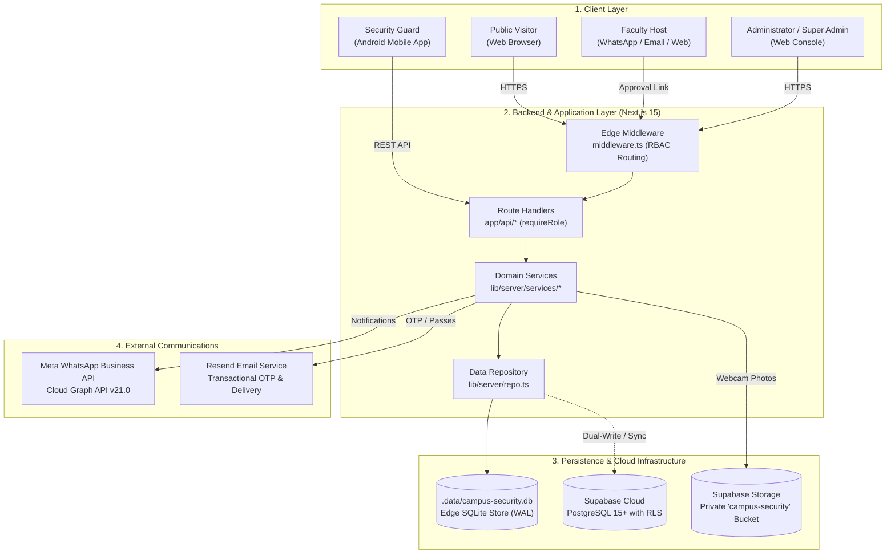

# Campus Security Management System (CSMS)
## System Architecture & End-to-End Communication Specification

**Institution:** Dev Sanskriti Vishwavidyalaya (DSVV), Haridwar  
**System:** Campus Security Management System (CSMS)  
**Document Version:** 2.0 (Updated November 2026)  
**Primary Stack:** Next.js 15 (App Router), React 19, TypeScript 5.7, Tailwind CSS, Radix UI, Supabase Cloud (PostgreSQL 15+ & Storage), React Native 0.86 / Expo SDK 57

---

## 1. High-Level Architecture Overview

The Campus Security Management System digitizes and secures campus access across Dev Sanskriti Vishwavidyalaya. It unifies public visitor pre-booking, faculty WhatsApp/Email approvals, security guard handheld operations, student hostel outpasses, and real-time administrative oversight.



---

## 2. End-to-End Communication Pipeline

The system establishes a clean, synchronous and real-time communication pipeline connecting the public web portal, backend API, Supabase cloud database, and the guard mobile application:

```
[Public Visitor / Web]
         │
         ▼  (1) Submits 4-section booking form & live facial photo
[Next.js Server API: /api/public/bookings]
         │
         ├─► (2) Uploads photo to Supabase Storage ('campus-security' bucket)
         ├─► (3) Commits pending record to Supabase PostgreSQL & SQLite store
         └─► (4) Dispatches WhatsApp message with single-use approval token
         │
         ▼
[Faculty Host WhatsApp / Email]
         │
         ▼  (5) Clicks "Approve" (Consumes cryptographic token)
[Next.js Server API: /api/faculty/decision]
         │
         ├─► (6) Updates status to APPROVED
         ├─► (7) Generates 32-char crypto random pass_token
         └─► (8) Issues digital QR pass to visitor
         │
         ▼
[Supabase Database (PostgreSQL 15)]
         │
         ▼  (9) Realtime replication / API query
[Guard Mobile Application (com.dsvv.campussecurity)]
         │
         ▼ (10) Guard scans QR pass at Main Gate (/api/gate/verify)
[Next.js Gate Engine: /api/gate/check-in]
         │
         ├─► (11) Validates pass status, date, and displays photo
         ├─► (12) Commits check_in_time & changes status to CHECKED_IN
         └─► (13) Emits audit log to check_logs
         │
         ▼
[Admin Dashboard Live Monitor (/admin/dashboard)]
```

---

## 3. Core Architectural Subsystems

### 3.1 Public Visitor Pre-Booking Subsystem
* Streamlined 4-section wizard with no extraneous scheduling questionnaires.
* Dynamic category selection: selecting `Visitor` automatically hides and clears the faculty host selection, allowing general university visits without mandatory host linkage.
* Dedicated headcount counter (`Number of Additional People`) with default `0`.
* Live client-side camera capture of visitor facial photo.
* Zero PII exposure in public QR payloads (stores only opaque tokens).

### 3.2 Gate Security & Mobile Verification Subsystem
* Dedicated native Android application in `mobile/` (`com.dsvv.campussecurity`).
* Camera-based QR code decoding via `expo-camera`.
* Gate In/Out state machine enforcing atomic check-in and check-out.
* Strict duplicate entry prevention: re-scanning an already active pass triggers a prominent rejection.
* Offline resilience backed by the local SQLite database running in Write-Ahead Logging (WAL) mode.

### 3.3 Role-Based Security & Authorization Subsystem
* Dedicated login routes: `/super-admin/login`, `/admin/login`, `/security/login`, `/teacher`, `/login`.
* Server-side `requireRole()` checks on every sensitive Route Handler.
* Edge middleware path evaluation using `PREFIX_ALLOWED_ROLES`.
* HTTP-only session cookies (`csms_session`) with 12-hour server expiration.
* Rate-limited 3-step OTP password recovery flow with scrypt hashing.

### 3.4 Guard Duty, Shifts & Patrols Subsystem
* Real-time gate staffing requirement evaluations.
* Guard shift start/end sessions with shift handover reporting.
* Handover checklists for physical gate equipment (Radios, Keys, Metal Detectors).
* Perimeter patrol tracking with GPS coordinates and mandatory checkpoint photos.

### 3.5 Student Hostel Outpass Subsystem
* Digital gate passes for hostel students.
* Warden review and digital approval workflow.
* Gate guard verification scan tracking student exit and entry times.
