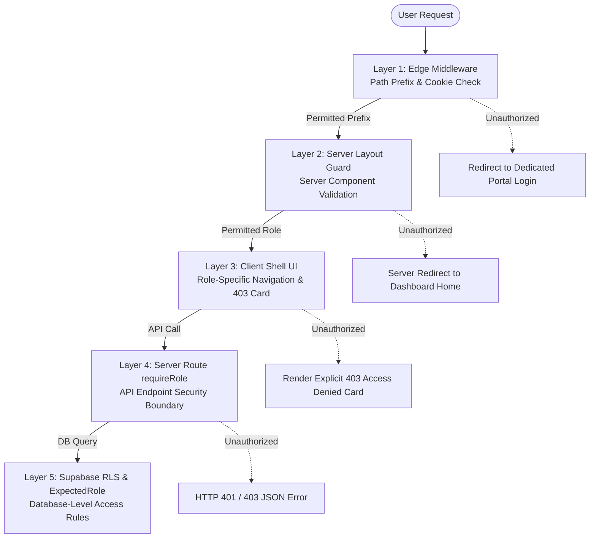
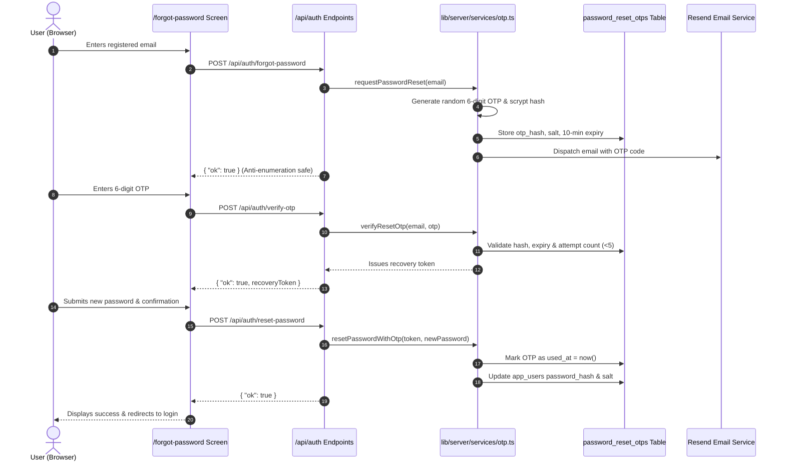

# Campus Security Management System (CSMS)
## Authentication & Role-Based Access Control (RBAC) Specification

**Institution:** Dev Sanskriti Vishwavidyalaya (DSVV), Haridwar  
**Security Architecture:** Multi-Layer Defense-in-Depth  
**Primary Engine:** Supabase Auth (PostgreSQL 15+)  
**Fallback Engine:** Edge SQLite Store (`app_users` + `sessions` with scrypt hashing)

---

## 1. Overview & 5-Layer Defense-in-Depth Architecture

To ensure strict boundary enforcement and prevent privilege escalation, CSMS implements a **5-Layer Security Architecture**:



### The 5 Security Layers:
1. **Edge Middleware (`middleware.ts`):** Evaluates path prefixes against `PREFIX_ALLOWED_ROLES`. Redirects unauthenticated users to the specific portal login and redirects logged-in users away from incorrect portals.
2. **Server Layout Guards (`app/**/layout.tsx`):** Server components verify session integrity before streaming HTML chunks to the browser.
3. **Client Shell 403 Protection (`components/**/shell.tsx`):** Renders an explicit `403 Forbidden` card if a client somehow accesses an unauthorized dashboard, providing a safe link back to the user's permitted home.
4. **Server-Side API Enforcement (`requireRole()` in `lib/server/auth.ts`):** The authoritative security boundary. Every sensitive Route Handler calls `requireRole(["admin", "super_admin"])` independently of client states or middleware cookies.
5. **Database-Level Policies (Supabase RLS):** Database rows are shielded using PostgreSQL Row Level Security policies.

---

## 2. Implemented Roles & Access Matrix

| Role | Target Portal | Login Route | Dashboard Home | Permitted Modules & Operations |
| :--- | :--- | :--- | :--- | :--- |
| `super_admin` | Super Admin Console | `/super-admin/login` | `/super-admin/dashboard` | Unrestricted access across the system: user provisioning, security settings, demo data reset, staff directories, all logs. |
| `admin` | Security Administrator | `/admin/login` | `/admin/dashboard` | Operational management: visitor approvals, guard scheduling, shift handovers, incident investigations, analytics, reports. |
| `security` | Guard Gate Console | `/security/login` | `/security/dashboard` | Gate operations: QR pass scanning, visitor check-in/out, guard duty start/end, shift handovers, patrol logs, emergency alerts. |
| `teacher` | Faculty Portal | `/teacher` | `/teacher/dashboard` | Academic host operations: review pending visitor meeting requests, approve/reject passes, configure consultation availability slots. |
| `student` | Student Portal | `/login` | `/student` | Student operations: request hostel gate outpasses, view pass status, view gate movement history. |
| `visitor` | Public Visitor Portal | `/` or `/login` | `/` (Home) | Public access: pre-book campus visits, track booking status, view issued digital QR pass. |

### Route Prefix Permissions Matrix

| Route Prefix | `super_admin` | `admin` | `security` | `teacher` | `student` | `visitor` |
| :--- | :---: | :---: | :---: | :---: | :---: | :---: |
| `/super-admin/*` | ✅ | ❌ | ❌ | ❌ | ❌ | ❌ |
| `/admin/*` | ✅ | ✅ | ❌ | ❌ | ❌ | ❌ |
| `/security/*` | ✅ | ✅ | ✅ | ❌ | ❌ | ❌ |
| `/teacher/*` | ✅ | ✅ | ❌ | ✅ | ❌ | ❌ |
| `/student/*` | ❌ | ❌ | ❌ | ❌ | ✅ | ❌ |
| `/visitor/*` | ❌ | ❌ | ❌ | ❌ | ❌ | ✅ |
| Public Pages (`/`, `/about`, etc.) | 🌐 | 🌐 | 🌐 | 🌐 | 🌐 | 🌐 |

---

## 3. Dedicated Login Portals & Redirection Logic

### 3.1 Portal Login Isolation
To prevent confusion and enforce administrative boundaries, login routes are strictly segregated:
* **Super Admin Login:** `/super-admin/login`
* **Admin Login:** `/admin/login`
* **Security Guard Login:** `/security/login`
* **Faculty Login:** `/teacher`
* **Shared / Student Login:** `/login`

When an authentication request is sent to `POST /api/auth/login`, the request payload includes an `expectedRole`. If the user's role in the database does not match the portal's `expectedRole`, access is rejected immediately:
```json
{
  "ok": false,
  "error": "You are not authorized to access this login portal.",
  "code": "AUTH_FORBIDDEN"
}
```

### 3.2 Safe Redirection & Open Redirect Prevention
The login form sanitizes the `?next=` query parameter using `getSafeRedirect()`:
* External URLs (e.g., `https://evil.com`) are stripped.
* Relative paths must match the user's permitted role prefix.
* If a guard enters `/admin/login?next=/admin/settings`, after login they are safely redirected to `/security/dashboard`.

---

## 4. Session Architecture & Cookie Hygiene

CSMS uses server-managed session cookies:

| Cookie Name | Scope | Security Flags | Purpose |
| :--- | :--- | :--- | :--- |
| `csms_session` | Server-only | `httpOnly`, `SameSite=Lax`, `Path=/`, `Secure` (in prod) | 64-byte cryptographic random token hash matching `sessions` table. Expiry: 12 hours. |
| `csms_role` | Client & Edge | `SameSite=Lax`, `Path=/` | Non-sensitive routing hint used by edge middleware to redirect users to their appropriate dashboard home. Never trusted for authorization. |

### Logout Flow
When `/api/auth/logout` is invoked:
1. The session record is deleted from the `sessions` table.
2. Both `csms_session` and `csms_role` cookies are cleared with `Max-Age=0`.
3. Subsequent requests to protected routes immediately redirect to the respective login screen.

---

## 5. Password Security & Scrypt Hashing

* **Algorithm:** scrypt (`node:crypto` native implementation).
* **Parameters:** `N=16384`, `r=8`, `p=1`, Key length: 64 bytes.
* **Salt:** 16 bytes of cryptographically secure random bytes generated per password.
* **Storage Format:** Stored as hex strings in `app_users.password_hash` and `app_users.password_salt`. Plaintext passwords are never logged or stored.

---

## 6. Password Reset & 3-Step OTP Workflow

For password recovery, CSMS implements a rate-limited, single-use 6-digit One-Time Password (OTP) workflow:



### Security Controls in OTP Workflow:
* **Time Expiry:** OTPs expire automatically after **10 minutes**.
* **Brute-Force Lockout:** Maximum **5 failed attempts** allowed per OTP; locked thereafter.
* **Resend Cooldown:** Minimum **60 seconds cooldown** between resend requests.
* **Single-Use Guarantee:** Once verified, `used_at` timestamp is committed, preventing replay.
* **Anti-Enumeration Protection:** Requests for unregistered email addresses return generic success messages to prevent email discovery.
