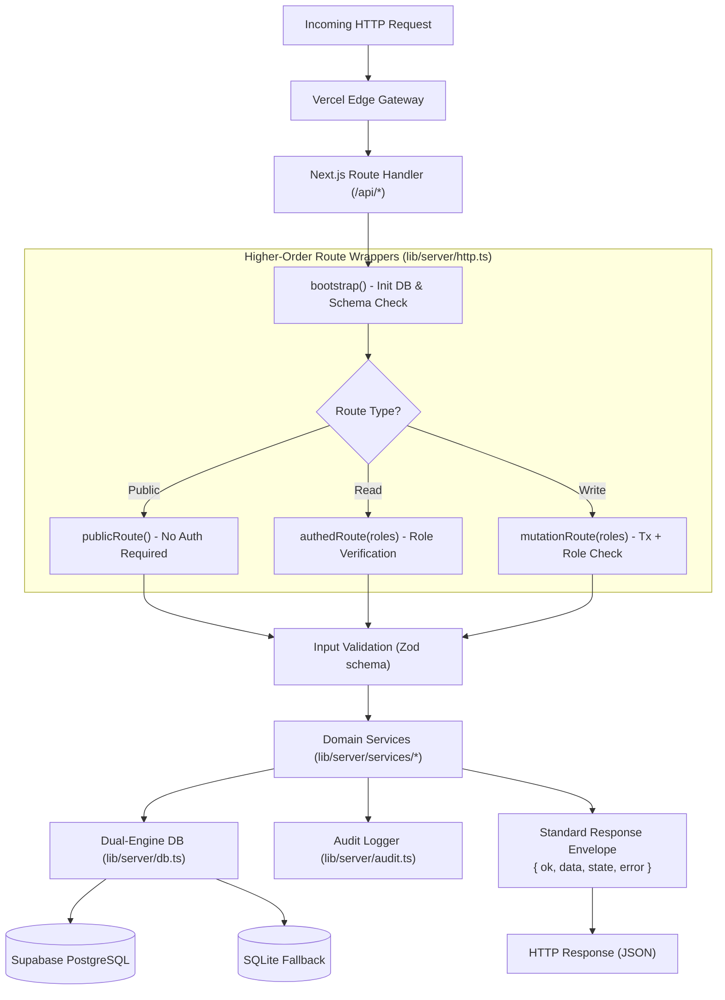

# Campus Security Management System (CSMS)
## Backend API Architecture & Endpoint Specification

**Runtime Engine:** Node.js 24 Runtime (`export const runtime = "nodejs"`)  
**Framework:** Next.js 15 App Router Route Handlers (`app/api/**/route.ts`)  
**Validation Engine:** Zod 4.6.1 (`lib/server/validation.ts`)  
**Base URL:** `https://campus-security-management.vercel.app/api`  

---

### 1. API Architecture Overview



---

### 2. Standard Response Envelope

All API endpoints return a standardized JSON envelope (`ApiEnvelope<T>`):

#### Success Response
```json
{
  "ok": true,
  "data": { ... },
  "state": { ... } // Optional fresh role-scoped database snapshot
}
```

#### Error Response
```json
{
  "ok": false,
  "error": {
    "message": "Human-readable explanation for security guards or visitors.",
    "code": "invalid_credentials | past_time | forbidden | not_found | conflict | internal_error",
    "details": {
      "fieldName": "Specific field validation failure reason"
    }
  }
}
```

---

### 3. Complete Domain API Directory

#### 3.1 Authentication & Sessions (`/api/auth/*`)

| Method | Endpoint | Access | Roles | Description |
|---|---|---|---|---|
| `POST` | `/api/auth/login` | Public | None | Authenticates with Supabase Auth or local DB. Sets httpOnly `csms_session` cookie and returns Bearer token. |
| `POST` | `/api/auth/logout` | Authenticated | All | Terminates session, clears cookie, and invalidates active token. |
| `GET` | `/api/auth/session` | Authenticated | All | Returns currently authenticated user identity, role, gate, and expiration. |
| `POST` | `/api/auth/signup` | Public | Visitor, Student | Public registration for visitor or student portal access. |
| `POST` | `/api/auth/forgot-password` | Public | None | Sends secure password reset link to user's registered email address. |
| `POST` | `/api/auth/reset-password` | Public | Token Bearer | Consumes password reset token and sets new password hash. |

#### 3.2 Visitor Management & Pre-Booking (`/api/bookings/*`, `/api/visitors/*`)

| Method | Endpoint | Access | Roles | Description |
|---|---|---|---|---|
| `POST` | `/api/bookings` | Public / Gate | Visitor, Security, Admin | Creates a new visitor booking. Calculates IST time slots, verifies host availability, encrypts Aadhaar, stores photo reference. |
| `GET` | `/api/bookings` | Authenticated | Admin, Super Admin | Lists all historical and upcoming visitor bookings with filtering. |
| `GET` | `/api/bookings/[id]` | Authenticated | Staff, Admin | Retrieves specific booking details, visitor record, and accompanying guests. |
| `POST` | `/api/bookings/[id]/guests` | Authenticated | Staff, Admin | Appends accompanying guests to an approved visit booking. |
| `GET` | `/api/visitors/[id]` | Authenticated | Staff, Admin | Retrieves detailed visitor profile, visit history, and blacklisted status. |

#### 3.3 Gate Verification & Movements (`/api/gate/*`)

| Method | Endpoint | Access | Roles | Description |
|---|---|---|---|---|
| `POST` | `/api/gate/verify` | Authenticated | Security, Admin | **Most Critical Gate Operation.** Scans QR code or reference. Validates token hash, checks date/time, verifies approval status, and returns visitor profile + next action (`check-in` or `check-out`). |
| `POST` | `/api/gate/check-in` | Authenticated | Security, Admin | Authorizes entry at campus gate. Transitions status to `Checked In`, logs guard ID, gate name, and entry timestamp. |
| `POST` | `/api/gate/check-out` | Authenticated | Security, Admin | Records exit from campus. Transitions status to `Checked Out`, logs exit gate, guard ID, and departure timestamp. |

#### 3.4 Guard Duty & Shift Management (`/api/guard-duty/*`, `/api/guards/*`)

| Method | Endpoint | Access | Roles | Description |
|---|---|---|---|---|
| `GET` | `/api/guard-duty/dashboard` | Authenticated | Security, Admin | Returns guard shift statistics, gate staffing levels, pending handovers, and active alerts. |
| `POST` | `/api/guard-duty/shift/start` | Authenticated | Security | Clocks in an assigned security guard for their scheduled gate shift. |
| `POST` | `/api/guard-duty/shift/end` | Authenticated | Security | Clocks out guard and creates a formal digital shift handover record. |
| `POST` | `/api/guard-duty/handovers/[id]/acknowledge` | Authenticated | Security | Incoming guard reviews and acknowledges incoming shift equipment and logs. |
| `POST` | `/api/guard-duty/handovers/[id]/decision` | Authenticated | Admin, Supervisor | Supervisor approves or rejects a completed shift handover with mandatory notes. |
| `GET` | `/api/guard-duty/patrols/routes` | Authenticated | Security, Admin | Retrieves configured campus security patrol routes and inspection checkpoints. |
| `POST` | `/api/guard-duty/patrols/submit` | Authenticated | Security | Submits patrol checkpoint inspection results with optional photo evidence. |
| `GET` | `/api/guards` | Authenticated | Admin | Retrieves security guard roster, active assignments, and gate staffing counts. |
| `POST` | `/api/guards` | Authenticated | Admin | Adds a new security guard profile and assigns employee credentials. |
| `GET` | `/api/guards/my-schedule` | Authenticated | Security | Returns current guard's scheduled shifts for the week. |

#### 3.5 Emergency SOS & Campus Incidents (`/api/sos/*`, `/api/incidents/*`, `/api/safety-issues/*`)

| Method | Endpoint | Access | Roles | Description |
|---|---|---|---|---|
| `POST` | `/api/sos` | Authenticated | Security, Admin, Staff | Dispatches instant campus emergency panic alert (Medical, Fire, Threat, Suspicious). |
| `GET` | `/api/sos` | Authenticated | Security, Admin | Lists active and historical emergency alerts with location coordinates. |
| `POST` | `/api/incidents` | Authenticated | Security, Admin | Logs a formal security incident report with severity rating. |
| `POST` | `/api/safety-issues` | Authenticated | Security, Admin | Reports physical campus hazards (e.g. broken lighting, damaged fence). |

#### 3.6 Faculty Approvals & Meta WhatsApp (`/api/faculty/*`, `/api/whatsapp/*`)

| Method | Endpoint | Access | Roles | Description |
|---|---|---|---|---|
| `POST` | `/api/faculty/visitor-requests/[id]/accept` | Authenticated | Host Faculty, Admin | Host faculty approves visitor request; triggers pass token issuance. |
| `POST` | `/api/faculty/visitor-requests/[id]/reject` | Authenticated | Host Faculty, Admin | Host faculty rejects visitor request; invalidates potential pass. |
| `POST` | `/api/faculty/decision` | Public (Token-gated)| Token Bearer | One-click decision endpoint for faculty clicking approval links inside WhatsApp messages. |
| `POST` | `/api/whatsapp/webhook` | Public (Signature-gated)| Meta | Inbound webhook receiver for Meta WhatsApp delivery receipts and incoming messages. |

#### 3.7 System State & Real-time Snapshot (`/api/state`, `/api/activity`)

| Method | Endpoint | Access | Roles | Description |
|---|---|---|---|---|
| `GET` | `/api/state` | Public / Auth | Dynamic (Role-Scoped)| Returns complete role-scoped dataset (visitors, gates, vehicles, alerts) for fast client hydration. |
| `GET` | `/api/activity` | Authenticated | Security, Admin | Returns recent chronological audit logs and gate movements. |

#### 3.8 Media & Visitor Photograph API (`/api/visitor-photo/*`)

| Method | Endpoint | Access | Roles | Description |
|---|---|---|---|---|
| `POST` | `/api/visitor-photo` | Public / Gate | Visitor, Security | Uploads visitor facial photo (JPEG/PNG/WebP, max 5MB). Sniffs magic bytes, enforces dimensions, and returns validated `photoId`. |
| `GET` | `/api/visitor-photo/[id]`| Authenticated | Security, Staff, Admin | Streams visitor photograph securely from private storage bucket after verifying staff session. |

---

### 4. Input Validation & Security Rules

All request payloads are parsed with strict Zod schemas (`lib/server/validation.ts`):
- `bookingSchema`: Validates full name (min 3 chars, letters only), Indian 10-digit mobile (`^[6-9]\d{9}$`), IST date/time slot, valid host department, optional vehicle registration (`^[A-Z]{2}[0-9]{1,2}[A-Z]{1,2}[0-9]{4}$`), and mandatory `photoId`.
- `verifySchema`: Enforces valid SHA-256 pass token hex string or valid booking reference (`DSVV-VIS-YYYY-XXXXXX`).
- `gateCheckSchema`: Requires booking ID, valid campus gate name (`Main Gate`, `North Gate`, `Service Gate`), and optional security officer notes.

