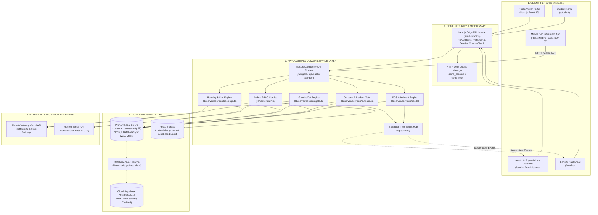

# Campus Security Management System (CSMS) - System Architecture Diagram
**Dev Sanskriti Vishwavidyalaya (DSVV), Haridwar**

---

## 1. High-Level Enterprise 4-Tier Architecture

---

## 2. Component Responsibility Matrix

| Component | Technology | Primary Function | Failure Mode / Resilience |
|---|---|---|---|
| **Public Portal** | Next.js 15, Tailwind, Radix UI | Pre-registration, visitor photo capture, pass download | Client-side validation; optimistic fallback |
| **Mobile Guard App** | React Native, Expo 57, Expo-Camera | Barcode scanner, manual reference search, Check-In/Out, SOS | Camera permission fallback to keyboard search |
| **Edge Middleware** | Next.js Edge Runtime (`middleware.ts`) | Route prefix checks, cross-role prevention | Strict 403 / redirect to dedicated login |
| **Local SQLite Engine** | Node.js `node:sqlite` (`DatabaseSync`) | Single-millisecond local reads/writes, zero gate latency | Write-Ahead Logging (WAL) mode |
| **Supabase Cloud DB** | PostgreSQL 15, PostgREST | Cloud backup, analytics, remote sync | Non-blocking secondary operations |
| **Communication Gateway** | Meta Cloud API & Resend | Pass delivery, meeting requests, OTP emails | Failsafe mock provider in development |
