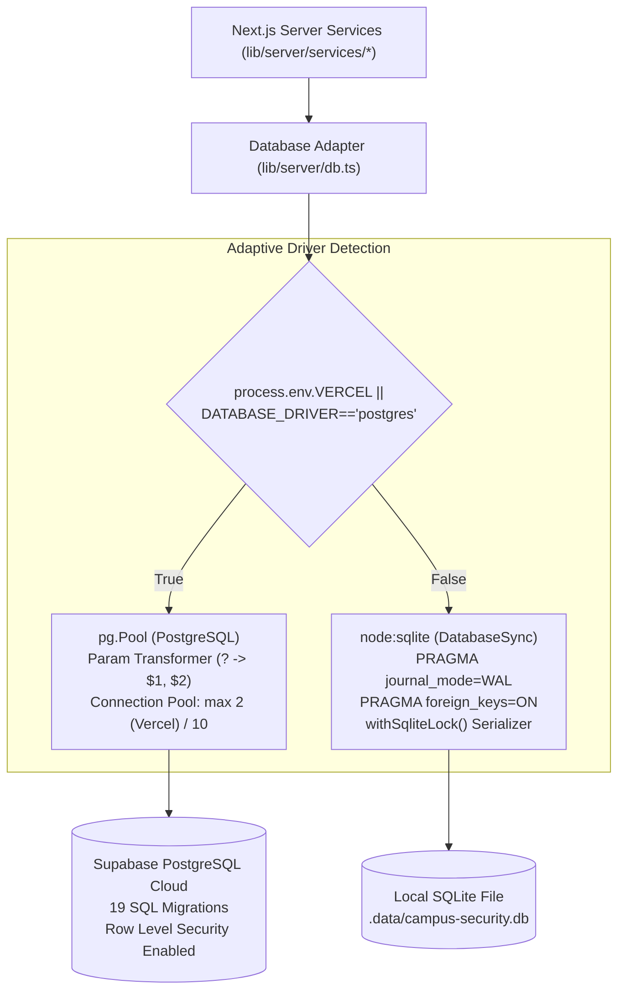

# Campus Security Management System (CSMS)
## Enterprise Database Architecture & Schema Specification

**Primary Database Engine:** Supabase PostgreSQL 15 (AWS ap-south-1 Mumbai)  
**Connection Mode:** Supavisor Connection Pooler (`aws-0-ap-south-1.pooler.supabase.com:6543`, Transaction Mode)  
**Fallback Local Engine:** Node.js 24 Native SQLite (`DatabaseSync`, WAL Mode)  
**Schema Version:** 3.0 (19 Version-Controlled SQL Migrations)  

---

### 1. Architectural Strategy & Dual-Engine Model

The database layer utilizes a dual-engine architecture designed to ensure zero downtime during network latency or edge operation.

---

### 2. Complete Entity Inventory & Relational Schema

#### 2.1 Identity & Access Control
- `public.profiles` / `app_users`:
  - `id` (text, PK): User identifier (UUID from `auth.users` in Supabase, `USR-XXXX` in SQLite).
  - `email` (text, Unique): Primary authentication address.
  - `full_name` / `name` (text): Officer / Administrator / Staff display name.
  - `role` (text): CHECK `role IN ('super_admin','admin','security','teacher','student','visitor')`.
  - `ref_id` (text, Nullable): Foreign reference to `security_guards(id)` or `teachers(id)`.
  - `active` (boolean / int): Flag indicating if account can log in.
- `public.sessions`: Session tokens with foreign key references to users and expiry timestamps.

#### 2.2 Visitor Management & Bookings
- `public.visitors`:
  - `id` (text, PK): Permanent visitor identifier (`VSTR-XXXXXX`).
  - `full_name` (text): Primary visitor name.
  - `mobile` (text, Indexed): 10-digit Indian phone number.
  - `aadhaar_hash` (text, Nullable): HMAC-SHA256 digest for duplicate detection.
  - `aadhaar_encrypted` (text, Nullable): AES-256-GCM ciphertext payload.
  - `photo_url` (text, Nullable): Storage path in `campus-security/visitor-photos/`.
  - `total_visits` (integer): Cumulative campus visit counter.
  - `blacklisted` (boolean): Security flag denying automatic clearance.
- `public.visit_requests`:
  - `id` (text, PK): Formatted reference (`DSVV-VIS-YYYY-XXXXXX`).
  - `visitor_id` (text, FK): References `visitors(id)` on delete cascade.
  - `host_id` (text, FK, Nullable): References `teachers(id)`.
  - `department` (text): Host faculty department name.
  - `visit_date` (text / date): ISO string `YYYY-MM-DD`.
  - `visit_time` (text / time): Scheduled entry slot `HH:MM`.
  - `status` (text): CHECK `status IN ('Pending','Approved','Rejected','Checked In','Meeting In Progress','Checked Out','Expired','Cancelled')`.
  - `pass_token` (text, Unique, Nullable): Opaque cryptographic random token.
  - `pass_token_hash` (text, Unique, Nullable): SHA-256 hash digest for QR validation.
  - `check_in_at` / `check_out_at` (timestamptz, Nullable): Gate movement timestamps.
- `public.visit_guests`: Accompanying guests linked to a parent visit request with individual ID details.

#### 2.3 Gate Operations & Vehicle Monitoring
- `public.campus_gates`:
  - `id` (text, PK): Gate ID (`GATE-001`, `GATE-002`, `GATE-003`).
  - `name` (text, Unique): `Main Gate`, `North Gate`, `Service Gate`.
  - `operating_hours` (text): `07:30 - 23:59`.
  - `active` (boolean): Operational status.
- `public.movements` / `check_logs`:
  - `id` (text, PK): `LOG-XXXXXX`.
  - `visit_request_id` (text, FK): References `visit_requests(id)`.
  - `direction` (text): CHECK `direction IN ('In', 'Out')`.
  - `gate` (text): Gate where entry/exit occurred.
  - `guard_name` / `guard_id` (text): Officer who authorized the movement.
  - `at` (timestamptz): Movement timestamp.
- `public.vehicles`:
  - `registration_number` (text, PK): Normalized plate number.
  - `type` (text): Car, Two Wheeler, Auto/Taxi, Bus, Goods.
  - `status` (text): CHECK `status IN ('Inside', 'Outside')`.

#### 2.4 Guard Duty, Patrols & Handover (Migration 0014)
- `public.gate_staffing_requirements`: Minimum and ideal guards per gate and shift.
- `public.guard_shift_assignments`: Scheduled gate assignments per date and guard.
- `public.guard_shift_sessions`: Actual clock-in/out records with `late_minutes` tracking.
- `public.patrol_routes` & `public.patrol_checkpoints`: Campus inspection zones with mandatory photo flags.
- `public.patrol_submissions`: Patrol checkpoint checklist submissions with Pass/Fail status.
- `public.shift_handovers` & `public.shift_handover_items`: Formal shift handover workflow with supervisor sign-off.

#### 2.5 Safety & Incidents
- `public.incidents`: Logged security incidents with severity ratings (`Low`, `Medium`, `High`, `Critical`).
- `public.emergencies` / `sos_alerts`: Real-time panic dispatch events with location metadata.
- `public.safety_issues`: Environmental hazard reports (e.g. electrical fault, damaged barrier).

---

### 3. Row Level Security (RLS) Policy Blueprint

All Supabase PostgreSQL tables have RLS enabled (`ALTER TABLE ... ENABLE ROW LEVEL SECURITY`):

| Table | Policy Name | Command | Rule Specification |
|---|---|---|---|
| `visitors` | `visitors_staff_read` | `SELECT` | `public.is_staff()` (Admins and Security Guards only). |
| `visit_requests` | `visits_public_read` | `SELECT` | `true` (Restricted to non-sensitive columns via views). |
| `visit_requests` | `visits_staff_write` | `INSERT/UPDATE` | `public.is_staff()` or authorized public booking wrapper. |
| `guard_shift_assignments` | `assignments_guard_read`| `SELECT` | `public.is_admin() OR guard_id = public.current_guard_id()` |
| `shift_handovers` | `handovers_write` | `INSERT/UPDATE` | `public.is_admin() OR public.current_role_name() = 'security'` |
| `storage.objects` | `visitor_photos_read` | `SELECT` | `bucket_id = 'campus-security' AND (storage.foldername(name))[1] = 'visitor-photos' AND public.is_staff()` |

---

### 4. Migration Progression (0001 - 0019)

1. `0001_schema.sql`: Core tables (users, visitors, visits, departments, gates).
2. `0002_rls.sql`: Base Row Level Security policies and helper functions.
3. `0003_visit_guests.sql`: Accompanying visitor tables.
4. `0004_faculty_notifications.sql`: Faculty visit request notifications.
5. `0005_visitor_photos.sql`: Private storage bucket and mandatory photo policies.
6. `0006_purpose_meta.sql`: Purpose metadata and department foreign keys.
7. `0007_visitor_simplification.sql`: Form simplification and ID validation.
8. `0008_restrict_visitor_access.sql`: Hardened public visitor access restrictions.
9. `0009_admin_email_restriction.sql`: Strictly locks admin role to `nikhilshukla1200@gmail.com`.
10. `0009_auth_profiles_and_roles.sql`: Syncs Supabase `auth.users` with `public.profiles`.
11. `0010_guard_dashboard.sql`: Guard metrics view and KPI calculations.
12. `0011_visitor_monthly_analytics.sql`: Monthly aggregated analytics.
13. `0012_gate_in_out_workflow.sql`: Movement integrity constraints and timestamps.
14. `0013_visitor_registration_fields.sql`: Added 4-section booking fields.
15. `0014_guard_duty_and_shift_handover.sql`: Guard duty, shift sessions, patrols, and digital handovers.
16. `0015_whatsapp_faculty_approval.sql`: WhatsApp approval tokens and message logs.
17. `0016_sos_enhanced.sql`: Emergency panic dispatch tables and notifications.
18. `0017_safety_issues.sql`: Physical campus safety hazard tracking.
19. `0018_student_outpass.sql`: Student movement and QR outpass permissions.

