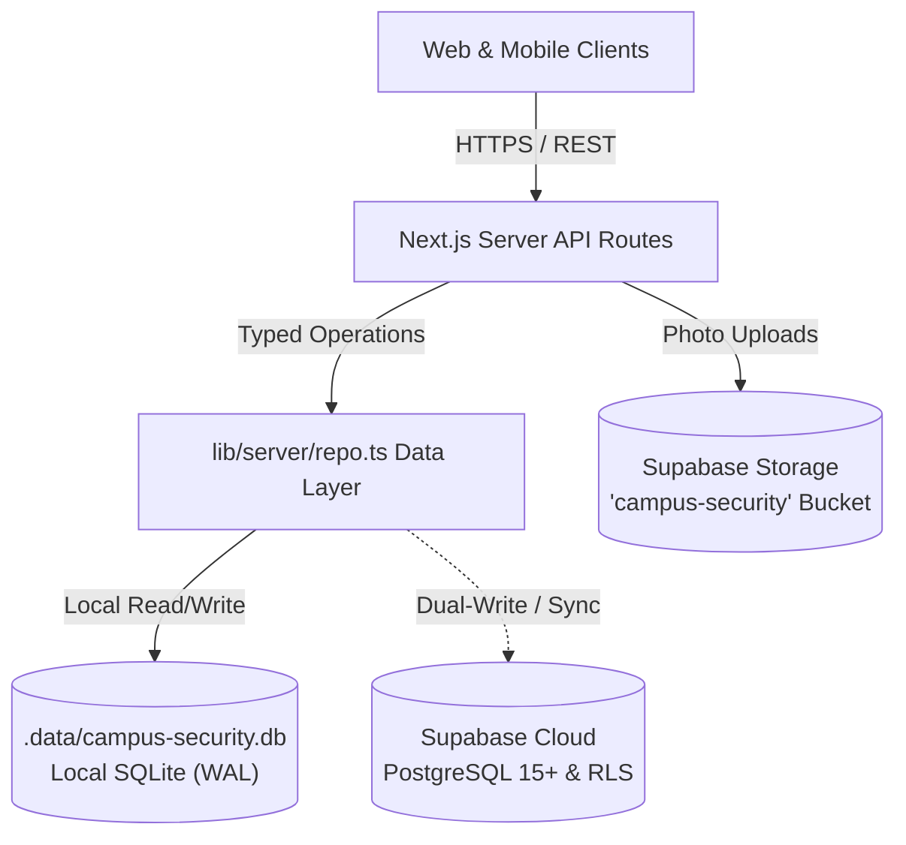
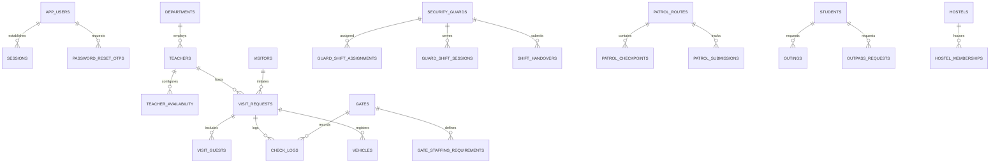

# Campus Security Management System (CSMS)
## Database Architecture & Complete Schema Specification

**Institution:** Dev Sanskriti Vishwavidyalaya (DSVV), Haridwar  
**System:** Campus Security Management System  
**Engines:** Supabase Managed Cloud (PostgreSQL 15+) & Local Edge Store (Node.js native SQLite with WAL)  
**ORM / Data Layer:** Next.js Server-Side Repository (`lib/server/repo.ts`), SQLite (`lib/server/db.ts`), and Supabase REST/PostgREST (`lib/server/supabase-db.ts`)

---

## 1. Overview & Dual-Database Strategy

The CSMS database architecture utilizes a **hybrid dual-engine model**:

1. **Cloud Production Store (Supabase PostgreSQL):** Authoritative persistent cloud database hosting user authentication (`auth.users`), full relational schemas, Row Level Security (RLS) policies, Realtime replication publications, and private photo storage (`campus-security` bucket).
2. **Local Edge Store (Node.js Native SQLite):** Zero-latency local SQLite database stored in `.data/campus-security.db` (or `/tmp/campus-security.db` in serverless cloud environments). Runs in **Write-Ahead Logging (WAL)** mode with immediate write serialization (`BEGIN IMMEDIATE`), foreign keys enabled, and automatic in-memory cache fallbacks.

---

## 2. Complete Entity-Relationship (ER) Diagram

---

## 3. Database Tables Reference

### 3.1 Authentication & System Security

#### `app_users`
Stores all provisioned user accounts for local authentication and fallback directory.
* `id` (TEXT, PK): Unique identifier (e.g., `USR-001`).
* `email` (TEXT, UNIQUE): User login email.
* `password_hash` (TEXT): Scrypt-derived password hash.
* `password_salt` (TEXT): Cryptographic salt for scrypt.
* `name` (TEXT): Display name.
* `role` (TEXT): User role (`super_admin`, `admin`, `security`, `teacher`, `student`, `visitor`).
* `ref_id` (TEXT, NULL): Foreign reference to associated entity (`teachers.id`, `security_guards.id`, `students.id`).
* `gate` (TEXT, NULL): Assigned gate station for guards.
* `active` (INTEGER): Status flag (`1` = active, `0` = disabled).
* `created_at` (TEXT): ISO-8601 creation timestamp.
* `updated_at` (TEXT): ISO-8601 update timestamp.

#### `sessions`
Server-managed active sessions for HTTP-only cookies.
* `id` (TEXT, PK): Unique session ID (`SESS-xxxxxx`).
* `user_id` (TEXT, FK -> `app_users.id`): Associated user.
* `token_hash` (TEXT, UNIQUE): SHA-256 hash of the 64-byte session token.
* `role` (TEXT): Cached user role at session creation.
* `created_at` (TEXT): Session creation timestamp.
* `expires_at` (TEXT): Session expiration timestamp (12-hour validity).

#### `password_reset_otps`
Stores single-use 6-digit OTP codes for password recovery.
* `id` (TEXT, PK): UUID.
* `email` (TEXT): Recipient email address.
* `otp_hash` (TEXT): Scrypt hash of the 6-digit OTP.
* `salt` (TEXT): Cryptographic salt.
* `attempts` (INTEGER): Attempt count (locked after 5 failed attempts).
* `max_attempts` (INTEGER): Default `5`.
* `created_at` (TEXT): Generation timestamp.
* `expires_at` (TEXT): Expiration timestamp (10-minute validity).
* `used_at` (TEXT, NULL): Timestamp when consumed (enforces single-use).

---

### 3.2 Campus Directory & Staff

#### `departments`
Academic and administrative faculties.
* `id` (TEXT, PK): Department code (`DEPT-001`).
* `name` (TEXT): Department title.
* `code` (TEXT, UNIQUE): Abbreviation (`YOGA`, `CS`, `AYUR`).
* `head_name` (TEXT): Head of Department.
* `location` (TEXT): Physical building/block.
* `phone` (TEXT): Office contact number.
* `email` (TEXT): Official department email.
* `active` (INTEGER): Status flag.

#### `teachers`
Faculty members and authorized visit hosts.
* `id` (TEXT, PK): Faculty identifier (`TCH-001`).
* `name` (TEXT): Full name.
* `email` (TEXT, UNIQUE): Institutional email address.
* `phone` (TEXT): Normalised phone number.
* `whatsapp_number` (TEXT, NULL): E.164 phone for WhatsApp approval dispatch.
* `department_id` (TEXT, FK -> `departments.id`): Associated department.
* `designation` (TEXT): Academic rank (Professor, HoD, Assistant Professor).
* `cabin_location` (TEXT): Office/cabin details.
* `active` (INTEGER): Availability status.

#### `teacher_availability`
Working hours and visitor consultation slots.
* `id` (TEXT, PK): Availability ID.
* `teacher_id` (TEXT, FK -> `teachers.id`): Associated teacher.
* `day_of_week` (INTEGER): 0 (Sunday) to 6 (Saturday).
* `start_time` (TEXT): Slot start (e.g., `10:00`).
* `end_time` (TEXT): Slot end (e.g., `13:00`).
* `is_available` (INTEGER): Flag.

#### `security_guards`
Campus security personnel stationed at entry points.
* `id` (TEXT, PK): Guard identifier (`GRD-001`).
* `name` (TEXT): Guard full name.
* `badge_number` (TEXT, UNIQUE): Security badge ID.
* `phone` (TEXT): Contact number.
* `assigned_gate` (TEXT): Primary assigned gate.
* `shift` (TEXT): Shift name (Morning, Evening, Night).
* `active` (INTEGER): Operational status.

---

### 3.3 Visitor Registration & Verification

#### `visitors`
Master registry of individuals who have visited or requested entry.
* `id` (TEXT, PK): Visitor record ID (`VSTR-xxxxxx`).
* `name` (TEXT): Full name.
* `phone` (TEXT): Contact mobile number.
* `email` (TEXT, NULL): Optional email.
* `id_type` (TEXT): Government ID category (`Aadhaar`, `Voter ID`, `Driving License`, `Passport`).
* `id_number_masked` (TEXT): Masked ID string (e.g., `XXXX-XXXX-1234`).
* `id_digest` (TEXT, NULL): Deterministic HMAC digest for duplicate visitor tracking.
* `photo_path` (TEXT, NULL): Relative storage path of facial photograph.
* `created_at` (TEXT): Initial registration timestamp.

#### `visit_requests`
The core transactional table representing campus visit bookings.
* `id` (TEXT, PK): Official booking reference (e.g., `DSVV-VIS-2026-000100`).
* `visitor_id` (TEXT, FK -> `visitors.id`): Registered visitor.
* `host_id` (TEXT, FK -> `teachers.id`, NULL): Faculty host (null when Category is General "Visitor").
* `host_name` (TEXT): Cached host name.
* `department_id` (TEXT, FK -> `departments.id`, NULL): Target department.
* `purpose_category` (TEXT): Primary purpose (Official, Academic, Meeting, Family, etc.).
* `purpose_description` (TEXT): Detailed reason for visit.
* `visitor_category` (TEXT): Category (`Visitor`, `Academic Visitor`, `Parent / Guardian`, `Official / Vendor`, `Alumni`, `Other`).
* `other_category` (TEXT, NULL): Description when category is `Other`.
* `specific_person` (TEXT, NULL): Name of specific person visiting.
* `additional_visitors` (INTEGER): Number of accompanying guests (default `0`).
* `visit_date` (TEXT): Scheduled date (`YYYY-MM-DD`).
* `visit_time` (TEXT): Expected arrival time (`HH:MM`).
* `departure_time` (TEXT): Expected departure time (`HH:MM`).
* `photo_path` (TEXT, NULL): Storage path for visitor photograph.
* `vehicle_required` (TEXT): `"yes"` or `"no"`.
* `vehicle_type` (TEXT, NULL): Car, Two Wheeler, Bus, Goods Vehicle, Other.
* `vehicle_number` (TEXT, NULL): Normalised vehicle registration plate.
* `status` (TEXT): `PENDING`, `APPROVED`, `REJECTED`, `CHECKED_IN`, `CHECKED_OUT`, `EXPIRED`, `CANCELLED`.
* `pass_token` (TEXT, UNIQUE, NULL): Opaque cryptographically random token embedded in QR pass.
* `badge_number` (TEXT, NULL): Physical visitor badge issued at gate.
* `check_in_time` (TEXT, NULL): Timestamp of entry.
* `check_out_time` (TEXT, NULL): Timestamp of departure.
* `check_in_gate` (TEXT, NULL): Gate where entry was recorded.
* `check_out_gate` (TEXT, NULL): Gate where exit was recorded.
* `guard_id` (TEXT, NULL): Guard who scanned and approved check-in.
* `created_at` (TEXT): ISO-8601 submission timestamp.
* `updated_at` (TEXT): ISO-8601 update timestamp.

#### `visit_guests`
Accompanying individuals registered under a primary booking.
* `id` (TEXT, PK): Unique guest ID.
* `visit_request_id` (TEXT, FK -> `visit_requests.id`): Parent booking.
* `name` (TEXT): Full name of accompanying guest.
* `relation` (TEXT, NULL): Relationship to primary visitor.

#### `check_logs`
Immutable audit log of all gate check-in and check-out events.
* `id` (TEXT, PK): Log entry ID (`CHK-xxxxxx`).
* `booking_id` (TEXT, FK -> `visit_requests.id`): Associated booking.
* `direction` (TEXT): `IN` or `OUT`.
* `gate` (TEXT): Gate name (Main Gate, Hostel Gate, etc.).
* `guard_id` (TEXT, FK -> `security_guards.id`): Guard on duty.
* `guard_name` (TEXT): Guard name snapshot.
* `timestamp` (TEXT): Exact timestamp of gate passage.
* `badge_number` (TEXT, NULL): Physical badge number assigned.

#### `approval_tokens`
Cryptographic single-use tokens for faculty approval links sent via WhatsApp and Email.
* `id` (TEXT, PK): Token UUID.
* `booking_id` (TEXT, FK -> `visit_requests.id`): Associated visit booking.
* `token_hash` (TEXT, UNIQUE): SHA-256 hash of the approval secret.
* `action` (TEXT): `ACCEPT` or `REJECT`.
* `expires_at` (TEXT): Expiry timestamp (24-hour validity).
* `consumed_at` (TEXT, NULL): Timestamp when link was clicked and action executed.

---

### 3.4 Guard Operations & Shift Handover

#### `gate_staffing_requirements`
Minimum guard requirements for each campus gate per shift.
* `id` (TEXT, PK): Requirement ID.
* `gate_name` (TEXT): Gate identifier.
* `shift_type` (TEXT): Morning, Evening, Night.
* `min_guards` (INTEGER): Minimum guards required.

#### `guard_shift_assignments`
Admin schedule assignments for security guards.
* `id` (TEXT, PK): Assignment ID (`ASG-xxxxxx`).
* `guard_id` (TEXT, FK -> `security_guards.id`): Scheduled guard.
* `gate_name` (TEXT): Assigned post.
* `shift_date` (TEXT): Scheduled date.
* `shift_start` (TEXT): Start time.
* `shift_end` (TEXT): End time.
* `status` (TEXT): `SCHEDULED`, `ACTIVE`, `COMPLETED`, `ABSENT`.

#### `guard_shift_sessions`
Active shift records started and ended by guards.
* `id` (TEXT, PK): Shift session ID.
* `guard_id` (TEXT, FK -> `security_guards.id`): Guard on duty.
* `gate_name` (TEXT): Gate station.
* `started_at` (TEXT): Shift start timestamp.
* `ended_at` (TEXT, NULL): Shift end timestamp.
* `status` (TEXT): `ACTIVE`, `ENDED`.

#### `shift_handovers`
End-of-shift handover report submitted by an outgoing guard.
* `id` (TEXT, PK): Handover ID (`HND-xxxxxx`).
* `outgoing_guard_id` (TEXT, FK -> `security_guards.id`): Guard finishing shift.
* `incoming_guard_id` (TEXT, NULL): Guard taking over.
* `gate_name` (TEXT): Gate station.
* `shift_session_id` (TEXT, FK -> `guard_shift_sessions.id`): Related shift.
* `notes` (TEXT): General briefing remarks.
* `visitor_count` (INTEGER): Visitors logged during shift.
* `open_incidents_count` (INTEGER): Unresolved incidents.
* `status` (TEXT): `PENDING_REVIEW`, `ACKNOWLEDGED`, `SUPERVISOR_APPROVED`, `REJECTED`.
* `submitted_at` (TEXT): Submission timestamp.
* `acknowledged_at` (TEXT, NULL): Incoming guard acknowledgment timestamp.

#### `shift_handover_items`
Physical equipment check items (Keys, Radios, Metal Detectors, Logbooks).
* `id` (TEXT, PK): Item ID.
* `handover_id` (TEXT, FK -> `shift_handovers.id`): Parent handover.
* `item_name` (TEXT): Equipment name.
* `status` (TEXT): `PRESENT`, `DAMAGED`, `MISSING`.
* `remarks` (TEXT, NULL): Details if damaged or missing.

#### `patrol_routes` & `patrol_checkpoints`
Configured security patrol tracks around campus perimeter.
* Routes: `id`, `name`, `description`, `estimated_duration_minutes`, `active`.
* Checkpoints: `id`, `route_id`, `name`, `location_description`, `sequence_order`, `qr_code_value`, `require_photo`.

#### `patrol_submissions`
Completed patrol rounds logged by security guards with GPS and photo proof.
* `id`, `route_id`, `guard_id`, `checkpoint_id`, `scanned_at`, `photo_path`, `notes`, `status`.

---

### 3.5 Safety, Incidents & Emergencies

#### `incidents` & `emergencies`
Log of campus disturbances, medical emergencies, fires, and security alerts.
* `incidents`: `id`, `title`, `description`, `category`, `severity`, `location`, `status`, `reported_by`, `created_at`.
* `emergencies`: `id`, `type`, `description`, `location`, `status` (`ACTIVE`, `RESOLVED`), `triggered_by`, `created_at`, `resolved_at`.

#### `safety_issues`
Physical hazard tickets reported by guards or administrators (e.g., broken streetlights, road blockages).
* `id`, `title`, `description`, `hazard_type`, `location`, `photo_path`, `status` (`REPORTED`, `IN_PROGRESS`, `RESOLVED`), `assigned_to`, `created_at`.

---

### 3.6 Student Outpass & Outings

#### `outpass_requests`
Digital gate outpasses requested by hostel students.
* `id` (TEXT, PK): Outpass ID (`OUT-xxxxxx`).
* `student_id` (TEXT, FK -> `students.id`): Student requesting exit.
* `outpass_type` (TEXT): Day Outing, Night Stay, Emergency Leave, Home Visit.
* `destination` (TEXT): Place visiting.
* `reason` (TEXT): Justification.
* `leave_time` (TEXT): Scheduled exit.
* `expected_return_time` (TEXT): Scheduled return.
* `warden_approval_status` (TEXT): `PENDING`, `APPROVED`, `REJECTED`.
* `actual_exit_time` (TEXT, NULL): Recorded gate exit.
* `actual_entry_time` (TEXT, NULL): Recorded gate return.

---

## 4. Supabase Migrations Chronology

All changes to the Supabase PostgreSQL database are tracked in `supabase/migrations/`:

| Migration File | Key Features & Tables Introduced |
| :--- | :--- |
| `0001_schema.sql` | Initial core tables: `departments`, `teachers`, `visitors`, `visit_requests`, `check_logs`, `vehicles`, `incidents`, `emergencies`. |
| `0002_rls.sql` | Base Row Level Security (RLS) policies for all core tables. |
| `0003_visit_guests.sql` | Support for accompanying party / guest members (`visit_guests`). |
| `0004_faculty_notifications.sql` | Faculty notification queue and communication logs. |
| `0005_visitor_photos.sql` | Storage bucket configuration and photo path columns. |
| `0006_purpose_meta.sql` | Purpose classification metadata and visit category tagging. |
| `0007_visitor_simplification.sql` | Simplification of public registration: dropped mandatory Aadhaar fields. |
| `0008_restrict_visitor_access.sql` | Hardened RLS preventing public reading of other visitor records. |
| `0009_admin_email_restriction.sql` | Enforces admin role restriction to `nikhilshukla1200@gmail.com`. |
| `0009_auth_profiles_and_roles.sql` | RBAC role definitions: `super_admin`, `admin`, `security`, `teacher`, `student`, `visitor`. |
| `0010_guard_dashboard.sql` | Guard shift tracking, gate station views, and real-time activity metrics. |
| `0011_visitor_monthly_analytics.sql` | Analytical aggregation views for administrative reporting. |
| `0012_gate_in_out_workflow.sql` | Gate verification constraints, direction validation, and pass token hashing. |
| `0013_visitor_registration_fields.sql` | Additional people counter, vehicle requirements, and specific host fields. |
| `0014_guard_duty_and_shift_handover.sql` | Duty assignments, shift sessions, equipment checklists, and handovers. |
| `0015_whatsapp_faculty_approval.sql` | Approval tokens, webhook signature validation, and WhatsApp messages table. |
| `0016_sos_enhanced.sql` | Enhanced emergency dispatch, incident assignments, and escalation checks. |
| `0017_safety_issues.sql` | Campus maintenance and hazard ticket management. |
| `0018_student_outpass.sql` | Student hostel memberships, outpass requests, and gate events. |
| `0019_password_reset_otps.sql` | Encrypted OTP store for password recovery with attempt rate-limiting. |

---

## 5. Row Level Security (RLS) Policy Architecture

Every Supabase table has Row Level Security enabled. The core rules are:

1. **`visit_requests`:**
   - **Public (Anon):** Can `INSERT` a new visit request via the public registration wizard. Cannot `SELECT` all bookings; can only view a single booking via exact matching `pass_token` or reference ID with mobile number verification.
   - **Faculty:** Can `SELECT` bookings where `host_id` matches their teacher ID.
   - **Security Guards:** Can `SELECT` all active bookings to perform gate verification. Can `UPDATE` `status`, `check_in_time`, and `check_out_time`.
   - **Admins & Super Admins:** Full `ALL` permissions.
2. **`password_reset_otps`:**
   - Public cannot access directly (`FOR ALL USING (false)`).
   - Only backend Route Handlers with the Supabase `service_role` key can insert and verify OTPs.
3. **`approval_tokens`:**
   - Token lookup is strictly restricted to matching the active SHA-256 hash.
4. **`guard_shift_sessions` & `shift_handovers`:**
   - Guards can view and submit their own shifts and handovers.
   - Supervisors and Admins can review, acknowledge, and approve handovers.

---

## 6. Storage Buckets

* **Bucket Name:** `campus-security`
* **Access Level:** Private
* **Storage Paths:**
  * `visitor-photos/{random_token}.jpg`: Live visitor webcam photos captured during pre-booking.
  * `patrol-photos/{checkpoint_id}_{timestamp}.jpg`: Guard patrol verification photos.
  * `hazard-photos/{issue_id}_{timestamp}.jpg`: Campus maintenance and safety issue photos.
* **Serving Mechanism:** Served via authenticated Next.js route `/api/visitor-photo/[id]` or temporary signed URLs.
