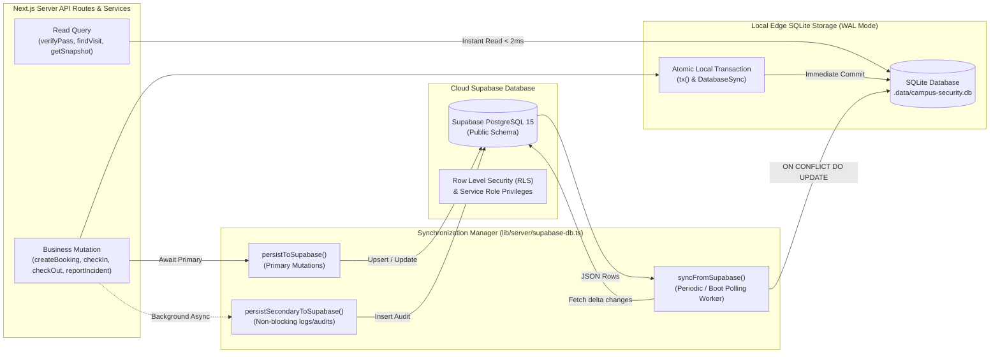

# Database Synchronization Architecture (SQLite & Supabase)
**Campus Security Management System (CSMS) — Dev Sanskriti Vishwavidyalaya**

---

## 1. Synchronization Architecture Overview

CSMS incorporates a **Hybrid Dual-Persistence Engine**:
* **Primary / Edge Tier:** Embedded local SQLite database (`.data/campus-security.db`) in WAL (Write-Ahead Logging) mode, providing millisecond-level responsiveness for high-throughput gate operations and local network independence.
* **Cloud / Source of Truth Tier:** Supabase PostgreSQL 15 cloud database with Row Level Security (RLS) policies, providing centralized audit trails, offsite backups, and multi-portal consistency.



---

## 2. Synchronization Mechanisms & Resilience Strategies

### A. Dual-Write on Mutations (Outbound Sync)
When a state change occurs (e.g. `checkIn()` or `createBooking()`):
1. **Local Transaction:** The data is committed locally to SQLite inside a `tx(() => { ... })` wrapper.
2. **Primary Cloud Persistence:** `persistToSupabase(table, data, operation)` executes an HTTP upsert (`admin.from(table).upsert(data, { onConflict: matchColumn })`).
3. **Secondary Cloud Persistence:** Optional audit trails (`activity_logs`, notifications, check logs) are sent via `persistSecondaryToSupabase()`, which executes in the background and catches errors silently without blocking gate throughput.

### B. Inbound Sync & Conflict Resolution (`syncFromSupabase`)
On application bootstrap or periodic invocation:
1. `syncFromSupabase(force)` queries all primary tables from Supabase (`campus_gates`, `departments`, `teachers`, `security_guards`, `students`, `visitors`, `visit_requests`).
2. **Partial Index Conflict Avoidance:** Each `visit_requests` row is upserted inside its own individual transaction:
   ```sql
   INSERT INTO visit_requests (...)
   VALUES (...)
   ON CONFLICT(id) DO UPDATE SET
     status = excluded.status,
     check_in_at = excluded.check_in_at,
     check_out_at = excluded.check_out_at,
     updated_at = excluded.updated_at;
   ```
3. If two concurrent Supabase rows share the same `(host_id, visit_date, visit_time)` slot, the second row triggers a catch block (`UNIQUE constraint failed`), logging a warning while preserving local database integrity without aborting the batch.

---

## 3. Data Integrity & Mapping Matrix

| Table Name | SQLite Primary Key | Supabase Mapping | Conflict Resolution Strategy |
|---|---|---|---|
| `visitors` | `id` (TEXT) | `public.visitors` | `ON CONFLICT (id) DO UPDATE` |
| `visit_requests` | `id` (`DSVV-VIS-...`) | `public.visit_requests` | `ON CONFLICT (id) DO UPDATE` |
| `check_logs` | `id` (`CHK-...`) | `public.check_logs` | Append-only / `INSERT` |
| `movements` | `id` (`MOV-...`) | `public.movements` | Append-only / `INSERT` |
| `vehicles` | `id` (`VEH-...`) | `public.vehicles` | `ON CONFLICT (id) DO UPDATE` |
| `incidents` | `id` (`INC-...`) | `public.incidents` | `ON CONFLICT (id) DO UPDATE` |
| `emergencies` | `id` (`SOS-...`) | `public.emergencies` | `ON CONFLICT (id) DO UPDATE` |
| `app_users` | `id` (TEXT) | `public.profiles` | Supabase Auth trigger + manual profile sync |
