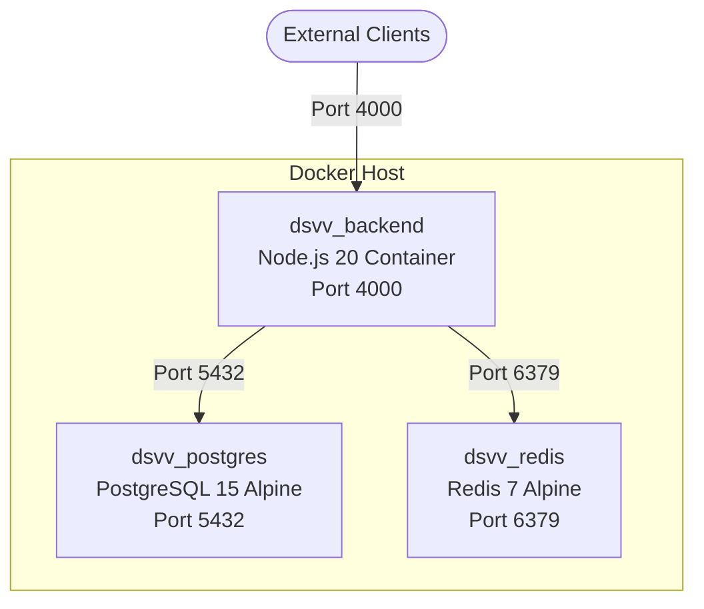

# Campus Security Management System (CSMS)
## Docker & Containerization Setup Guide

**Institution:** Dev Sanskriti Vishwavidyalaya (DSVV), Haridwar  
**Configuration Files:** `docker-compose.yml`, `backend/Dockerfile`  
**Services:** PostgreSQL 15, Redis 7, Backend Service

---

## 1. Container Architecture Overview

The system includes Docker orchestration via `docker-compose.yml` for self-hosted containerized environments:



---

## 2. Service Definitions in `docker-compose.yml`

| Service Name | Container Name | Base Image | Internal Port | Host Port | Data Volume |
| :--- | :--- | :--- | :--- | :--- | :--- |
| `postgres` | `dsvv_postgres` | `postgres:15-alpine` | `5432` | `5432` | `postgres_data` |
| `redis` | `dsvv_redis` | `redis:7-alpine` | `6379` | `6379` | `redis_data` |
| `backend` | `dsvv_backend` | Custom Multi-Stage (Node 20) | `4000` | `4000` | — |

---

## 3. Prerequisites

Before running the containers, ensure you have:
* **Docker Engine:** v24.0+ or **Docker Desktop** installed on your workstation.
* **Docker Compose:** v2.20+ (included with Docker Desktop).
* **RAM Allocation:** Minimum 4 GB recommended.

---

## 4. Environment Variables Configuration

Create a `.env` file in the project root (or set system environment variables):

```env
POSTGRES_PASSWORD=your_secure_postgres_password_here
JWT_ACCESS_SECRET=your_jwt_access_secret_32_chars_min
JWT_REFRESH_SECRET=your_jwt_refresh_secret_32_chars_min
```

---

## 5. Execution Commands

### 5.1 Build and Start Containers
To build the backend image and launch all services in detached mode:
```powershell
docker compose up -d --build
```

### 5.2 Verify Running Services
```powershell
docker compose ps
```
All containers (`dsvv_postgres`, `dsvv_redis`, `dsvv_backend`) should show status `Up`.

### 5.3 Inspect Container Logs
```powershell
# Follow all logs
docker compose logs -f

# Follow backend logs specifically
docker compose logs -f backend

# Follow postgres logs specifically
docker compose logs -f postgres
```

### 5.4 Stop and Teardown Containers
```powershell
# Stop running containers
docker compose stop

# Stop and remove containers and networks
docker compose down

# Stop, remove containers, and purge persistent database volumes
docker compose down -v
```

---

## 6. Troubleshooting Docker Issues

| Symptom | Root Cause | Solution |
| :--- | :--- | :--- |
| `POSTGRES_PASSWORD: required variable not set` | Missing `.env` file or variable | Set `POSTGRES_PASSWORD` in your `.env` file before invoking `docker compose up`. |
| Port `5432` or `6379` already allocated | Local PostgreSQL or Redis instance is running on host machine | Stop local services (`net stop postgresql` on Windows) or re-map host ports in `docker-compose.yml` (e.g., `'5433:5432'`). |
| Backend fails to connect to database | Postgres container still initializing when backend starts | The backend service includes automatic reconnection retry logic; check `docker compose logs backend` to confirm connection established. |
