# Campus Security Management System (CSMS)
## Enterprise Entity-Relationship (ER) Diagram & Schema Specification

**Institution:** Dev Sanskriti Vishwavidyalaya (DSVV), Haridwar  
**Engine:** Supabase PostgreSQL 15 & SQLite Hybrid Model  
**Notation:** Crow's Foot Entity-Relationship Modeling (Mermaid)  

---

### 1. Master Entity-Relationship Diagram

```mermaid
erDiagram
    PROFILES ||--o{ SESSIONS : "opens"
    PROFILES ||--o| SECURITY_GUARDS : "identifies"
    PROFILES ||--o| TEACHERS : "identifies"
    PROFILES ||--o| STUDENTS : "identifies"

    DEPARTMENTS ||--o{ TEACHERS : "employs"
    DEPARTMENTS ||--o{ VISIT_REQUESTS : "hosts"

    VISITORS ||--o{ VISIT_REQUESTS : "initiates"
    VISIT_REQUESTS ||--o{ VISIT_GUESTS : "includes"
    VISIT_REQUESTS ||--o{ MOVEMENTS : "records"
    VISIT_REQUESTS }o--|| TEACHERS : "meets"

    CAMPUS_GATES ||--o{ MOVEMENTS : "controls"
    CAMPUS_GATES ||--o{ GUARD_SHIFT_ASSIGNMENTS : "staffs"
    CAMPUS_GATES ||--o{ SHIFT_HANDOVERS : "transfers"

    SECURITY_GUARDS ||--o{ GUARD_SHIFT_ASSIGNMENTS : "scheduled"
    GUARD_SHIFT_ASSIGNMENTS ||--o| GUARD_SHIFT_SESSIONS : "executes"
    GUARD_SHIFT_SESSIONS ||--o| SHIFT_HANDOVERS : "concludes"
    GUARD_SHIFT_SESSIONS ||--o{ PATROL_SUBMISSIONS : "logs"

    PATROL_ROUTES ||--o{ PATROL_CHECKPOINTS : "contains"
    PATROL_CHECKPOINTS ||--o{ PATROL_SUBMISSIONS : "inspected_at"
    SHIFT_HANDOVERS ||--o{ SHIFT_HANDOVER_ITEMS : "details"

    STUDENTS ||--o{ OUTINGS : "requests"
    CAMPUS_GATES ||--o{ OUTINGS : "clears"

    PROFILES ||--o{ INCIDENTS : "reports"
    PROFILES ||--o{ EMERGENCIES : "dispatches"
    PROFILES ||--o{ NOTIFICATIONS : "receives"
    PROFILES ||--o{ AUDIT_LOGS : "acts"

    PROFILES {
        uuid id PK
        string email UK
        string full_name
        string role "super_admin, admin, security, teacher, student, visitor"
        string ref_id FK
        boolean active
        timestamptz last_login_at
    }

    VISITORS {
        string id PK "VSTR-XXXXXX"
        string full_name
        string mobile UK
        string aadhaar_hash "HMAC-SHA256"
        string aadhaar_encrypted "AES-256-GCM"
        string photo_url "campus-security/visitor-photos"
        int total_visits
        boolean blacklisted
    }

    VISIT_REQUESTS {
        string id PK "DSVV-VIS-YYYY-XXXXXX"
        string visitor_id FK
        string host_id FK
        string department
        date visit_date
        time visit_time
        string status "Pending, Approved, Rejected, Checked In, Checked Out, Expired"
        string pass_token UK "Opaque Nonce"
        string pass_token_hash UK "SHA-256"
        boolean vehicle_required
        string vehicle_number
        timestamptz check_in_at
        timestamptz check_out_at
    }

    CAMPUS_GATES {
        string id PK "GATE-XXX"
        string name UK "Main Gate, North Gate, Service Gate"
        string operating_hours
        boolean active
    }

    MOVEMENTS {
        string id PK "LOG-XXXXXX"
        string visit_request_id FK
        string direction "In, Out"
        string gate
        string guard_id
        string guard_name
        timestamptz at
    }

    SECURITY_GUARDS {
        string id PK "GRD-XXX"
        string full_name
        string badge_number UK
        string primary_gate
        string phone
        string status "Active, On Duty, Off Duty, On Leave"
    }

    GUARD_SHIFT_ASSIGNMENTS {
        string id PK "ASG-XXXXXX"
        string guard_id FK
        string gate
        date duty_date
        string shift_type "Morning, Evening, Night, Custom"
        time start_time
        time end_time
        string status "Scheduled, Active, Completed, Reassigned"
    }

    GUARD_SHIFT_SESSIONS {
        string id PK "SES-XXXXXX"
        string assignment_id FK
        string guard_id
        string gate
        timestamptz actual_start
        timestamptz actual_end
        string checkin_status "On-Time, Late, Early"
        int late_minutes
        string status "Active, Handover Pending, Completed"
    }

    PATROL_ROUTES {
        string id PK "RTE-XXX"
        string name UK
        string zone
        int frequency_hours
        boolean active
    }

    PATROL_CHECKPOINTS {
        string id PK "CKPT-XXX"
        string route_id FK
        string title
        string location
        boolean photo_required
    }

    PATROL_SUBMISSIONS {
        string id PK "SUB-XXXXXX"
        string session_id FK
        string checkpoint_id FK
        string guard_id
        string status "Pass, Fail, N/A"
        string observations
        string photo_url
        timestamptz submitted_at
    }

    SHIFT_HANDOVERS {
        string id PK "HND-XXXXXX"
        string session_id FK
        string outgoing_guard_id
        string incoming_guard_id
        string gate
        string status "Draft, Submitted, Awaiting Incoming Guard, Acknowledged, Approved, Rejected"
        jsonb equipment_details
        string urgent_issues
        timestamptz submitted_at
    }

    SHIFT_HANDOVER_ITEMS {
        string id PK "HI-XXXXXX"
        string handover_id FK
        string category "Visitor, Incident, Equipment, Patrol"
        string reference_id
        string title
        boolean acknowledged_by_incoming
    }

    OUTINGS {
        string id PK "OUT-XXXXXX"
        string student_id FK
        string direction "Entry, Exit"
        string reason
        timestamptz scheduled_out
        timestamptz actual_out
        timestamptz actual_in
        string status "Approved, Out, Returned, Overstayed"
    }

    EMERGENCIES {
        string id PK "EMG-XXXXXX"
        string category "Medical, Fire, Threat, Suspicious, Other"
        string severity "Low, Medium, High, Critical"
        string location
        string reported_by
        timestamptz created_at
        string status "Active, Responded, Resolved"
    }

    AUDIT_LOGS {
        string id PK "AUD-XXXXXX"
        string actor_id
        string actor_name
        string actor_role
        string action
        string target_id
        jsonb details
        string ip_address
        timestamptz timestamp
    }
```

---

### 2. Relational Integrity Rules & Foreign Keys

1. **Cascade vs Restrict Rules:**
   - Deleting a `VISITOR` is `RESTRICTED` if historical `VISIT_REQUESTS` exist to preserve legal campus entry records.
   - Deleting a `VISIT_REQUEST` cascades to child `VISIT_GUESTS` and `MOVEMENTS`.
   - Deleting a `GUARD_SHIFT_ASSIGNMENT` cascades to child `GUARD_SHIFT_SESSIONS` and `SHIFT_HANDOVERS`.
2. **Deterministic Uniqueness:**
   - `VISITORS(mobile)` is unique per active record.
   - `VISIT_REQUESTS(pass_token_hash)` is unique.
   - `PROFILES(email)` is strictly unique across the institution.
3. **Audit Immutability:**
   - `AUDIT_LOGS` contains no `ON UPDATE` triggers and no `DELETE` policies, guaranteeing a tamper-proof event history.

