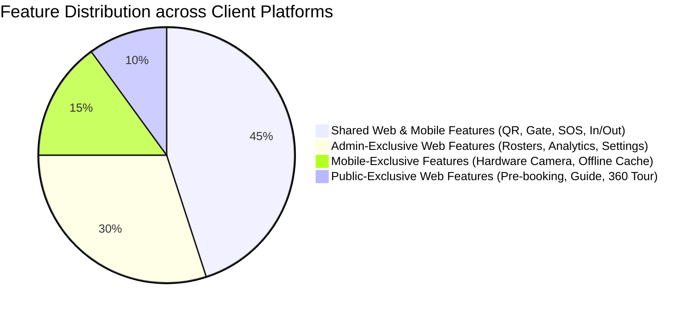

# Campus Security Management System (CSMS)
## Enterprise Feature & Capability Matrix

**Institution:** Dev Sanskriti Vishwavidyalaya (DSVV), Haridwar  
**System Scope:** Public Website, Admin Console, Guard Mobile App, API Gateway, Supabase Cloud Database  

---

### 1. Functional Matrix by User Role

| Domain / Feature | Visitor | Security Guard | Security Supervisor | Faculty / Staff | Student | System Admin | Web Component | Mobile Screen | Backend API Route | Primary Database Table | Current Status |
|---|:---:|:---:|:---:|:---:|:---:|:---:|---|---|---|---|:---:|
| **Public Visitor Pre-Booking** | ✅ | — | — | — | — | — | `BookingWizard` | — | `POST /api/bookings` | `visit_requests` | **Completed** |
| **Pass Status Lookup** | ✅ | — | — | — | — | — | `BookingStatusLookup` | — | `GET /api/bookings/[id]` | `visit_requests` | **Completed** |
| **QR Pass Display & Download** | ✅ | — | — | — | — | — | `PassQR` | — | `GET /visitor/pass/[id]` | `visit_requests` | **Completed** |
| **Guard Secure Login** | — | ✅ | ✅ | — | — | ✅ | `LoginScreen` | `login.tsx` | `POST /api/auth/login` | `profiles` / `app_users` | **Completed** |
| **Hardware QR Gate Scan** | — | ✅ | ✅ | — | — | ✅ | `QrScanner` | `scan.tsx` | `POST /api/gate/verify` | `visit_requests` | **Completed** |
| **Gate Check-In (Entry)** | — | ✅ | ✅ | — | — | ✅ | `GateConsole` | `verification.tsx`| `POST /api/gate/check-in`| `movements` / `check_logs` | **Completed** |
| **Gate Check-Out (Exit)** | — | ✅ | ✅ | — | — | ✅ | `GateConsole` | `check-out.tsx` | `POST /api/gate/check-out`| `movements` / `check_logs` | **Completed** |
| **Walk-in Visitor Registration**| — | ✅ | ✅ | — | — | ✅ | `BookingWizard` | `check-in.tsx` | `POST /api/bookings` | `visitors`, `visit_requests`| **Partial** (Fixing photo upload) |
| **Live Operational KPI Cards** | — | ✅ | ✅ | — | — | ✅ | `StatCard` | `dashboard.tsx` | `GET /api/state`, `/guard-duty/dashboard` | Aggregated Views | **Partial** (Fixing `data?.state`) |
| **Guard Duty Shift Clock In/Out**| — | ✅ | ✅ | — | — | ✅ | `GuardScheduleDialog` | `dashboard.tsx` | `POST /api/guard-duty/shift/*` | `guard_shift_sessions` | **Partial** (Dynamic session ID) |
| **Digital Shift Handover** | — | ✅ | ✅ | — | — | ✅ | `HandoverConsole` | Planned v2 | `POST /api/guard-duty/handovers/*` | `shift_handovers` | **Completed (Web)** |
| **Patrol Route Submissions** | — | ✅ | ✅ | — | — | ✅ | `PatrolConsole` | Planned v2 | `POST /api/guard-duty/patrols/submit` | `patrol_submissions` | **Completed (Web)** |
| **Emergency Panic SOS** | — | ✅ | ✅ | ✅ | ✅ | ✅ | `EmergencyDialog` | `emergency.tsx` | `POST /api/sos` | `emergencies` | **Completed** |
| **WhatsApp Meeting Approval** | — | — | — | ✅ | — | ✅ | `WhatsAppPanel` | — | `POST /api/faculty/decision` | `visit_requests`, `whatsapp_messages` | **Completed** |
| **Student Outpass Verification**| — | ✅ | ✅ | — | ✅ | ✅ | `GateConsole` | `scan.tsx` | `POST /api/outpass/scan` | `outings`, `students` | **Completed** |
| **Visitor Registry Management** | — | — | ✅ | — | — | ✅ | `VisitTable` | `history.tsx` | `GET /api/bookings` | `visit_requests` | **Completed** |
| **Guard Roster Management** | — | — | ✅ | — | — | ✅ | `GuardFormDialog` | — | `GET/POST /api/guards` | `security_guards` | **Completed** |
| **Security Audit Logs** | — | — | ✅ | — | — | ✅ | `ActivityFeed` | — | `GET /api/activity` | `audit_logs` | **Completed** |
| **Monthly Analytics & Export** | — | — | — | — | — | ✅ | `VisitorAnalyticsCharts` | — | `GET /api/admin/visitor-analytics` | `visit_requests` (Aggregated)| **Completed** |
| **Super Admin System Settings** | — | — | — | — | — | ✅ | `SettingsPage` | — | `POST /api/settings` | `schema_meta` / `app_settings`| **Completed** |

---

### 2. Platform Feature Distribution

---

### 3. Acceptance Verification Mapping

| Module | Verification Test Script | Success Criteria |
|---|---|---|
| Visitor Booking | `tests/unit.mjs` & `tests/prebooking.mjs` | Slot availability calculated in IST; Aadhaar encrypted under AES-256-GCM; Photo hash verified. |
| WhatsApp Approvals | `tests/whatsapp-faculty-approval.mjs` | Single-use 24-hr token validated; Status transitions to `Approved`; Zero PII leaked in notifications. |
| Gate Movement | `tests/gate-in-out-workflow.mjs` | Invalid/expired passes rejected; Duplicate entry denied; Check-out updates departure timestamp. |
| Guard Handover | `tests/guard-duty-handover.mjs` | Shift overlap detected; Outgoing handover requires supervisor review; Staffing shortfall flagged. |
| Android APK | Physical Sideload Installation | App installs cleanly on Android 11+; Camera scans physical QR in <500ms; Server records entry. |

