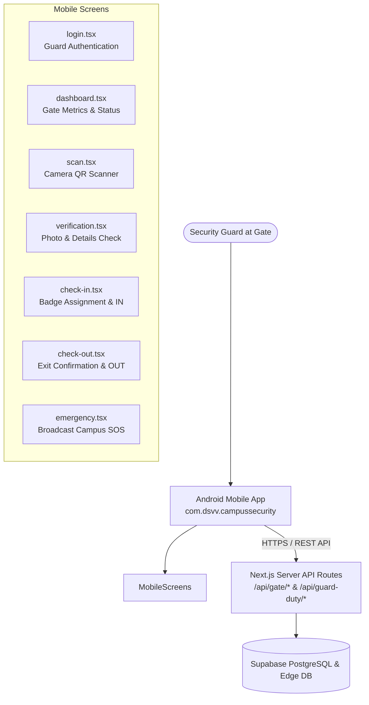

# Campus Security Management System (CSMS)
## Dedicated Android Guard Mobile Application Specification

**Institution:** Dev Sanskriti Vishwavidyalaya (DSVV), Haridwar  
**Application Title:** Campus Security Guard  
**Package Identifier:** `com.dsvv.campussecurity`  
**Location:** `/mobile`  
**Technology Stack:** React Native 0.86 / Expo SDK 57 / Expo Router / TypeScript

---

## 1. Application Overview

The **Campus Security Guard** mobile application is a native Android application built specifically for security personnel stationed at DSVV campus entry gates (Main Gate, Hostel Gate, VIP Gate). It provides fast, handheld visitor pass verification, hardware camera QR scanning, gate check-in/out logging, emergency distress broadcasting, and guard shift handover management.



---

## 2. Framework & Dependencies

| Dependency | Version | Purpose |
| :--- | :--- | :--- |
| `expo` | `~57.0.27` | Application framework and native runtime |
| `react-native` | `0.86.3` | Native cross-platform engine |
| `react` | `19.2.3` | Component architecture |
| `expo-router` | `~57.0.25` | File-system-based typed navigation |
| `expo-camera` | `~57.0.6` | Native camera module for real-time QR barcode scanning |
| `expo-image-picker`| `~57.0.20` | Native gallery/camera picker for optional photos |
| `lucide-react-native` | `^1.55.0` | Production vector icons |
| `react-native-reanimated` | `4.5.1` | Native animations |
| `react-native-safe-area-context` | `~5.7.0` | Notch and device bezel management |

---

## 3. Screen Hierarchy & Key Workflows

The mobile navigation is organized under `mobile/src/app/`:

1. **Guard Login (`login.tsx`):**
   * Guard signs in using registered email and approved password (or taps **Register New Guard** to request approval).
   * Validates guard credentials against `/api/auth/login` with `expectedRole: "security"`.
   * Displays immediate status feedback if account is `PENDING`, `REJECTED`, or `SUSPENDED`.
   * Securely caches user token and gate assignment in local storage.
2. **Guard Dashboard (`dashboard.tsx`):**
   * Displays currently assigned gate (e.g., Main Gate) and active shift time.
   * Shows live counts: visitors on campus, today's total entries, pending arrivals.
   * Quick access buttons to QR Scanner, Manual Verification, and Campus SOS.
3. **Camera QR Scanner (`scan.tsx`):**
   * Full-screen viewfinder using `expo-camera`.
   * Real-time barcode detection extracts the opaque pass token from the QR code.
   * Automatically opens `verification.tsx` upon detection with zero delay.
4. **Visitor Verification (`verification.tsx`):**
   * Calls `POST /api/gate/verify` with the scanned token.
   * Renders the visitor's live webcam photograph for visual identification.
   * Displays: Visitor name, contact, vehicle registration plate, accompanying headcount, meeting host, and pass status.
5. **Gate Check-In (`check-in.tsx`):**
   * Guard inputs or selects an assigned physical visitor badge (e.g., `B-102`).
   * Calls `POST /api/gate/check-in`.
   * Returns confirmation and marks the pass as active inside campus.
6. **Gate Check-Out (`check-out.tsx`):**
   * Scans departing visitor pass.
   * Calls `POST /api/gate/check-out`.
   * Confirms departure time and closes the visitor pass.
7. **Campus Emergency SOS (`emergency.tsx`):**
   * One-tap emergency broadcast (Fire, Medical, Security Lockdown, Distress).
   * Instantly alerts security supervisors and admin dashboards.

---

## 4. Local Development & Android Studio Setup

### Prerequisites
* **Node.js:** v20+ or v24.x
* **Android Studio:** Hedgehog / Iguana / Jellyfish with:
  * Android SDK Platform 34 or 35
  * Android SDK Build-Tools 34.0.0
  * Android Virtual Device (AVD) or physical Android device with USB debugging enabled.

### Local Run Commands
```powershell
# 1. Navigate to the mobile directory
cd mobile

# 2. Install dependencies
npm install

# 3. Verify TypeScript compilation
npx tsc --noEmit

# 4. Start the Expo development server
npx expo start

# 5. Launch directly on connected Android device/emulator
npx expo run:android
```

---

## 5. APK Generation Guide

### Option A: Local Build via Gradle (Offline / Android SDK)
The native Android project is prebuilt and maintained in `mobile/android/`.

To compile a standalone Debug APK locally:
```powershell
cd mobile/android
.\gradlew.bat assembleDebug
```

#### Output Location:
```
mobile/android/app/build/outputs/apk/debug/app-debug.apk
```

To compile a signed Release APK locally:
```powershell
cd mobile/android
.\gradlew.bat assembleRelease
```

#### Output Location:
```
mobile/android/app/build/outputs/apk/release/app-release.apk
```

### Option B: Cloud Build via Expo Application Services (EAS)
If Android SDK is not installed locally, generate an APK using EAS Cloud:
```powershell
# 1. Install EAS CLI
npm install -g eas-cli

# 2. Log in to Expo
eas login

# 3. Trigger cloud build using the production profile
cd mobile
eas build --profile production --platform android
```
The resulting installable `.apk` link will be output directly in the console.

---

## 6. Physical Device Installation Instructions

1. Transfer the compiled `.apk` to your Android device via USB, Google Drive, or WhatsApp.
2. Open the `.apk` file using your Android file manager.
3. If prompted with *"For your security, your phone is not allowed to install unknown apps from this source"*, tap **Settings** and enable **Allow from this source**.
4. Tap **Install**.
5. Launch **Campus Security Guard** from the home screen.
6. Grant required runtime permissions:
   * **Camera:** Required for scanning visitor QR passes.
   * **Network / Internet:** Required for validating passes against the campus database.
7. Sign in using approved guard credentials or complete the registration form for administrator review.
