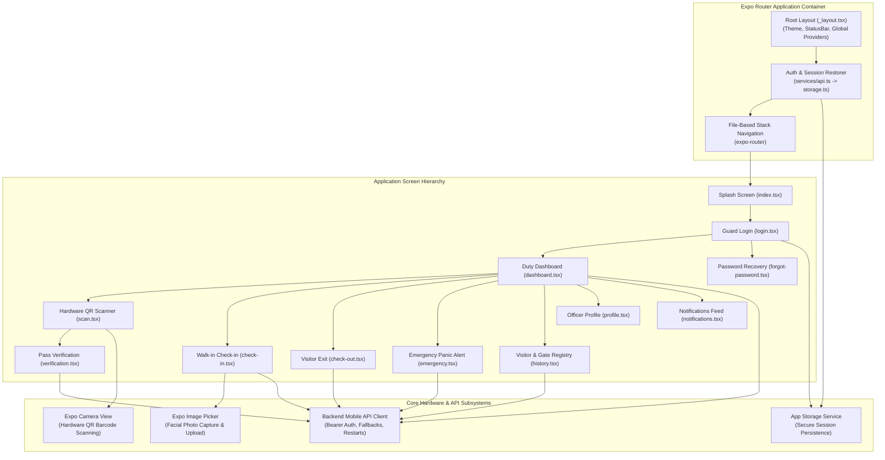

# Campus Security Guard Mobile Application Architecture

**Target Platform:** Android (Google Play / Sideloaded APK) & iOS  
**Framework:** React Native 0.86.3, Expo SDK 57.0.28, Expo Router 57.0.25  
**Package Identifier:** `com.dsvv.campussecurity`  
**Application Name:** Campus Security Guard  

---

### 1. Mobile Application Architectural Overview

---

### 2. User Roles & Permission Matrix

| Role Identifier | Role Label | Permitted Screens & Operations | Restraints |
|---|---|---|---|
| `security` | Security Guard / Gate Officer | Scan QR, Verify Pass, Mark In/Out, Walk-in Check-in, Emergency SOS, Shift Clock In/Out, Profile. | Cannot approve handovers, cannot modify gate configurations or access admin metrics. |
| `security_supervisor` | Security Supervisor | All Guard functions + Handover Approval, Guard Roster Inspection, Incident Escalation, Patrol Review. | Restricted from super-admin system resets and faculty record modifications. |
| `admin` / `super_admin` | Security Administrator | Complete mobile application access including bypass verification, all gate overrides, and emergency broadcast. | Full administrative privileges. |

---

### 3. Screen Hierarchy & Navigation Flow

1. **Splash & Session Check (`/` - `src/app/index.tsx`):**
   - Automatically invokes `restoreGuardSession()`.
   - If an active session token exists in `appStorage`, transitions immediately to `/dashboard`.
   - If expired or unauthenticated, transitions to `/login`.
2. **Guard Login (`/login` - `src/app/login.tsx`):**
   - Work email and password authentication calling `POST /api/auth/login`.
   - Validates user role: rejects unauthorized roles (`visitor`, `student`).
   - Persists session credentials (`GuardSession`) in local storage.
3. **Guard Dashboard (`/dashboard` - `src/app/dashboard.tsx`):**
   - Fetches live statistics from `GET /api/guard-duty/dashboard` and `GET /api/state`.
   - Displays 4 key operational KPI cards: Visitors Today, Currently Inside, Vehicles Inside, Active Alerts.
   - Shift Status Banner with Clock-in / Clock-out button.
   - Quick action grid: Scan Visitor QR, New Check-in, Check-out, Emergency SOS.
4. **QR Code Scanner (`/scan` - `src/app/scan.tsx`):**
   - Native camera viewport utilizing `expo-camera` (`CameraView`) with back facing and flash toggle.
   - Real-time barcode listener configured exclusively for `['qr']`.
   - Manual lookup fallback allowing guards to type booking references (e.g. `DSVV-VIS-2026-000124`).
   - Navigates to `/verification` with scanned code payload.
5. **Pass Verification & In/Out (`/verification` - `src/app/verification.tsx`):**
   - Server-side pass lookup via `POST /api/gate/verify`.
   - Displays visitor identity, facial photograph, host details, visit purpose, vehicle registration, and status badge.
   - Smart action buttons: Displays **Mark IN** if eligible for entry; displays **Mark OUT** if currently on campus.
   - Confirmation dialog before recording database mutation.
6. **Walk-in Check-in (`/check-in` - `src/app/check-in.tsx`):**
   - Allows gate guards to register unexpected visitors on the spot.
   - Captures visitor photo via camera/gallery (`expo-image-picker`).
   - Multi-field input: Full name, 10-digit mobile, purpose, host department/name, vehicle details.
   - Two-step transactional submission: (1) Upload photo to get `photoId`, (2) Create booking & mark IN at gate.
7. **Visitor Check-out (`/check-out` - `src/app/check-out.tsx`):**
   - Lists only visitors currently marked as `Checked In` or `Meeting In Progress`.
   - Instant text search across name, phone, or pass reference.
   - One-tap check-out confirmation with gate logging.
8. **Emergency SOS (`/emergency` - `src/app/emergency.tsx`):**
   - 5 critical incident categories: Medical Emergency, Fire or Smoke, Security Threat, Suspicious Activity, Other.
   - Severity selection: Low, Medium, High, Critical.
   - Instant dispatch via `POST /api/sos` notifying security control room and campus administrators.

---

### 4. Hardware & Platform Integrations

1. **Camera Subsystem (`expo-camera`):**
   - Permission management: Requests `android.permission.CAMERA` with graceful fallback to manual code lookup if denied.
   - Hardware flash toggle for nighttime gate scanning.
   - Barcode debounce: Internal reference flag (`scanned.current = true`) prevents multiple rapid triggers.
2. **Photo Capture (`expo-image-picker`):**
   - Square/4:3 aspect ratio crop with 0.8 JPEG compression for low-bandwidth cellular transmission.
   - Direct multipart streaming to backend storage.
3. **Session Persistence (`services/storage.ts`):**
   - Built on `AsyncStorage` / `expo-file-system` ensuring credentials survive app termination and device restarts.
   - Auto-expiry cleanup after 12 hours matching server JWT lifecycle.

---

### 5. Offline Capabilities & Network Resilience

- **Transient Disconnection Handling:** When outer campus gates experience poor cellular reception, verification operations detect network failures and surface actionable alerts rather than crashing.
- **In-Memory Cache:** The active guard profile and gate assignments remain cached during temporary disconnections.
- **Planned Offline Queue:** Walk-in records and check-outs will be written to a local SQLite/AsyncStorage buffer with background sync when connectivity resumes.

---

### 6. Build & Packaging Architecture (Expo EAS)

- **Configuration:** `eas.json` specifies build profiles for `development`, `preview`, and `production`.
- **Target Artifact:** Configured with `"buildType": "apk"` under `production.android` to ensure a direct, sideloadable `.apk` file is generated instead of an Android App Bundle (`.aab`).
- **Environment Binding:** Injects `EXPO_PUBLIC_API_URL` during build to bind directly to the production backend URL (`https://campus-security-management.vercel.app`).

