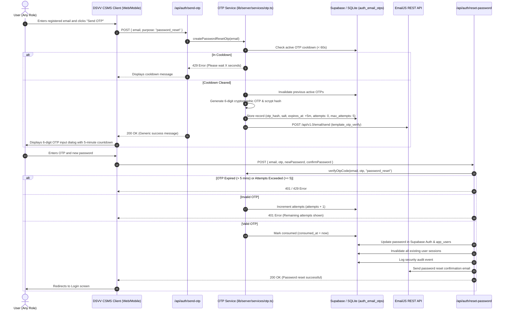
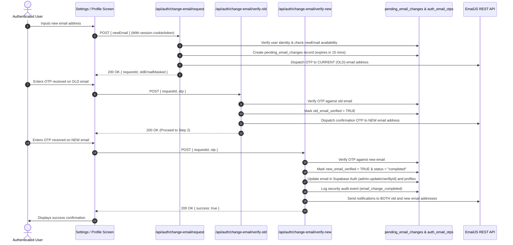

# OTP Authentication Flow & Lifecycle Guide
## Project: DSVV Campus Security Management System (CSMS)

This document details the end-to-end lifecycle, security controls, and step-by-step state transitions for all One-Time Password (OTP) workflows in DSVV CSMS.

---

## 1. Workflows Covered

1. **Forgot Password with OTP Verification** (Applicable to all roles: `super_admin`, `admin`, `security`, `teacher`, `student`, `visitor`).
2. **Two-Step Email Change with Old & New Email Verification**.
3. **Signup Email Verification & Account Activation**.

---

## 2. Forgot Password Flowchart

---

## 3. Two-Step Email Change Flow

To ensure maximum security and avoid account takeover via hijacked sessions, email change requires **two sequential OTP verifications**:

---

## 4. Key Security Rules & Boundaries

| Parameter | Specification | Purpose |
| :--- | :--- | :--- |
| **Length** | 6 numeric digits (`000000` to `999999`) | Optimal usability vs. entropy |
| **Expiry** | Exactly 5 minutes (`300 seconds`) | Minimizes exposure window |
| **Maximum Attempts** | 5 incorrect attempts | Thwarts brute-force attacks |
| **Resend Cooldown** | 60 seconds | Throttles abuse & flooding |
| **Storage** | `scrypt` hash with unique 16-byte salt | Plaintext never saved or logged |
| **Consumption** | Single-use (`consumed_at` timestamp) | Prevents replay attacks |
| **Enumeration Defense** | Uniform response on Forgot Password | Does not leak user existence |
