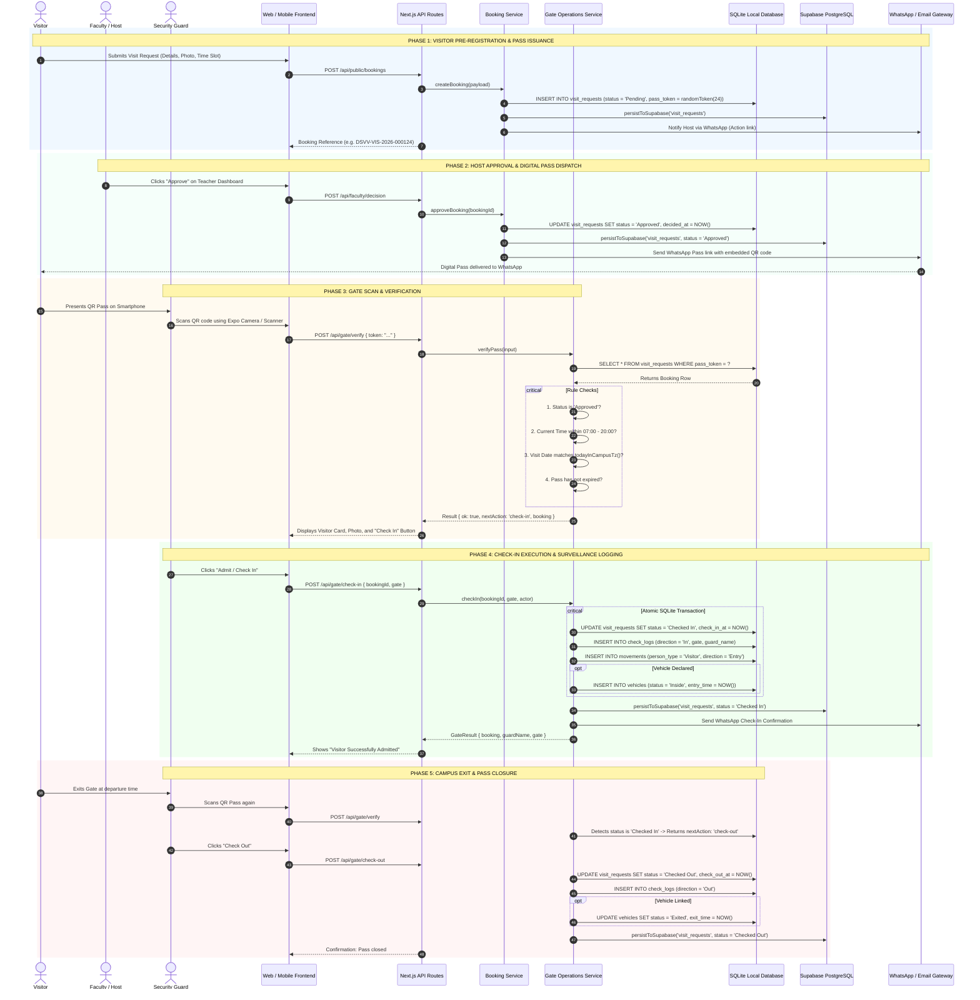

# Visitor QR Pass Generation & Gate Verification Sequence
**Dev Sanskriti Vishwavidyalaya (DSVV), Haridwar**

---

## 1. End-to-End Sequence Diagram

The following sequence diagram details the full lifecycle: from visitor pre-registration and host approval to QR token generation, gate scanning, validation, and physical check-in/check-out.

---

## 2. Gate Verification Rules Engine (State Decision Logic)

| Input State | Condition | Evaluated Result | Action Prompted |
|---|---|---|---|
| Status = `Pending` | Awaiting faculty approval | `ok: false, code: "not_approved"` | Reject Entry |
| Status = `Approved` | Date is today, within 07:00–20:00 | `ok: true, issues: []` | **Check-In (`nextAction: 'check-in'`)** |
| Status = `Approved` | Date > today (Future) | `ok: false, code: "too_early"` | Reject Entry |
| Status = `Approved` | Date < today (Past) | `ok: false, code: "date_passed"` | Reject Entry |
| Status = `Approved` | Time outside 07:00–20:00 | `ok: false, code: "outside_hours"` | Reject Entry |
| Status = `Checked In` | Visitor currently on campus | `ok: true, issues: []` | **Check-Out (`nextAction: 'check-out'`)** |
| Status = `Checked Out` | Pass already closed | `ok: false, code: "used"` | Reject Entry |
| Status = `Rejected` | Cancelled or Denied | `ok: false, code: "rejected"` | Reject Entry |
