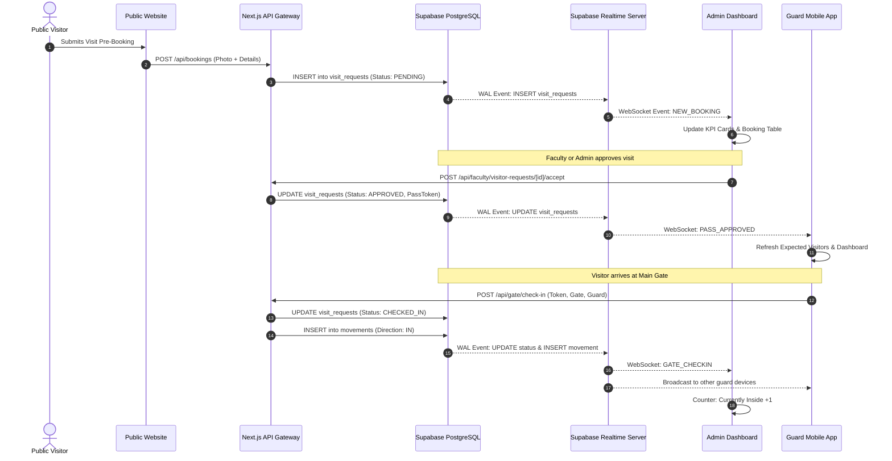

# Campus Security Management System (CSMS)
## Real-Time Synchronization & Multi-Platform Event Architecture

**Ecosystem Scope:** Public Website ↔ Backend Gateway ↔ Supabase Cloud ↔ Admin Console ↔ Guard Mobile Application  
**Real-Time Engine:** Supabase Realtime (PostgreSQL CDC via WebSockets) + HTTP Snapshot Fallback  
**Protocol:** WebSocket (`wss://`) with Exponential Backoff Auto-Reconnect  

---

### 1. Synchronization Topology



---

### 2. Core Real-Time Event Matrix

| Event Name | Originating Action | PostgreSQL Source Table | Payload Data | Target Subscribers | SLA Latency |
|---|---|---|---|---|---|
| `VISITOR_REGISTERED` | Public / Walk-in Booking | `visit_requests` (INSERT) | Booking ID, Visitor Name, Department, Date, Time | Admin Dashboard, Guard Mobile | < 1.0s |
| `VISITOR_APPROVED` | Faculty / Admin Approval | `visit_requests` (UPDATE) | Booking ID, Pass Token Hash, Status | Public Status Page, Mobile App | < 1.0s |
| `VISITOR_REJECTED` | Faculty / Admin Rejection | `visit_requests` (UPDATE) | Booking ID, Status: REJECTED | Public Status Page, Admin Logs | < 1.0s |
| `GATE_CHECK_IN` | Guard scans & confirms entry | `movements` (INSERT) | Booking ID, Gate, Guard ID, Timestamp IN | Admin Dashboard, All Mobile Apps | < 500ms |
| `GATE_CHECK_OUT` | Guard confirms exit | `movements` (INSERT) | Booking ID, Gate, Guard ID, Timestamp OUT | Admin Dashboard, All Mobile Apps | < 500ms |
| `SHIFT_STARTED` | Guard clocks in for duty | `guard_shift_sessions` (INSERT) | Guard ID, Gate, Status: ACTIVE | Admin Roster, Mobile Dashboards | < 1.0s |
| `HANDOVER_SUBMITTED` | Guard clocks out & hands over | `shift_handovers` (INSERT) | Handover ID, Gate, Equipment, Pending count | Incoming Guard Mobile, Supervisor | < 1.0s |
| `EMERGENCY_SOS` | Guard/Staff triggers panic | `emergencies` (INSERT) | Category, Severity, Location, Area | All Admins, All Guards (Alarm Audio) | < 300ms |

---

### 3. Subscription Channels & Filtering

To conserve client battery and network bandwidth on mobile devices, Supabase Realtime channels apply strict table and row-level filters:

#### Channel 1: Campus Gate Operations (`gate-channel`)
```typescript
const gateChannel = supabase
  .channel('gate-movements')
  .on(
    'postgres_changes',
    { event: 'INSERT', schema: 'public', table: 'movements' },
    (payload) => handleGateMovement(payload.new)
  )
  .subscribe();
```

#### Channel 2: Emergency SOS Broadcast (`emergency-channel`)
```typescript
const emergencyChannel = supabase
  .channel('emergency-alerts')
  .on(
    'postgres_changes',
    { event: 'INSERT', schema: 'public', table: 'emergencies' },
    (payload) => handleEmergencyAlert(payload.new)
  )
  .subscribe();
```

#### Channel 3: Guard Duty & Handover (`duty-channel`)
```typescript
const dutyChannel = supabase
  .channel(`duty-${currentGate}`)
  .on(
    'postgres_changes',
    { event: '*', schema: 'public', table: 'shift_handovers', filter: `gate=eq.${currentGate}` },
    (payload) => handleHandoverUpdate(payload.new)
  )
  .subscribe();
```

---

### 4. Hybrid Snapshot Polling Fallback

In real-world university environments, security guards at outer gates (e.g. Service Gate or Riverbank Post) may encounter cellular disconnects where WebSockets drop. CSMS implements a self-healing **Hybrid Realtime + Snapshot Sync**:

1. **Active WebSocket Mode:** When online, changes arrive instantly via Supabase Realtime.
2. **Heartbeat & Disconnect Detection:** If the WebSocket connection fails for >15 seconds, the mobile application switches to Adaptive HTTP Polling (`GET /api/state`).
3. **Adaptive Backoff Intervals:**
   - App in foreground: Polls every 10 seconds.
   - App idle: Polls every 30 seconds.
   - Network failure: Exponential backoff (5s, 10s, 20s, up to 60s).
4. **Resync on Reconnection:** When WebSocket reconnects, the mobile app immediately requests a full `/api/state` snapshot to reconcile any missed events.

---

### 5. Idempotency & Conflict Resolution

- **Concurrent Check-In Protection:** If two guards scan the same pass simultaneously, database transactions enforce `status = 'Approved'` as an atomic precondition (`UPDATE visit_requests SET status = 'Checked In' WHERE id = ? AND status = 'Approved'`). The second update fails with `409 Conflict`.
- **Offline Draft Separation:** Walk-in records generated offline are tagged with `isOfflineDraft: true` and a client-side UUID. When uploaded, the server uses this UUID as an idempotency key to prevent duplicate booking rows.

