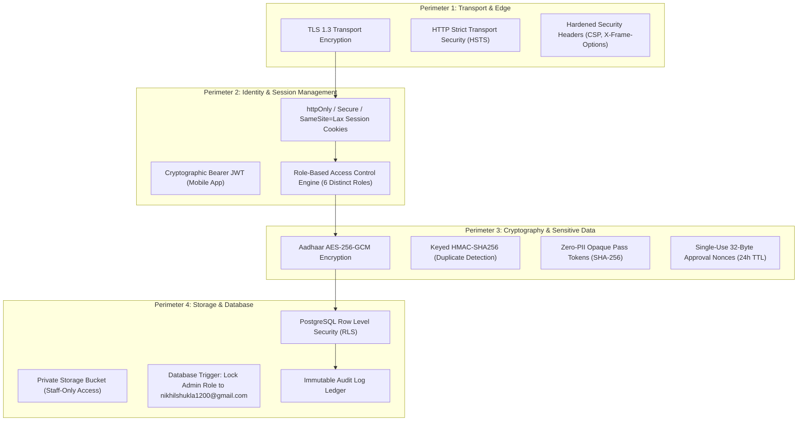

# Campus Security Management System (CSMS)
## Enterprise Security Architecture & Data Protection Blueprint

**Compliance Baseline:** Digital Personal Data Protection Act (DPDPA 2023), ISO/IEC 27001, OWASP Top 10 API Security  
**Scope:** Identity, Cryptography, Data at Rest, Data in Transit, Access Control, and Physical Gate Security  

---

### 1. Multi-Tier Security Perimeter



---

### 2. Identity, Authentication & Role Hierarchy

#### 2.1 Role Matrix & Capabilities

| Role Code | Description | Default Landing Route | API Gate Access |
|---|---|---|---|
| `super_admin` | University Head of Security & IT Director | `/admin/dashboard` | Unrestricted access; system configuration; database maintenance. |
| `admin` | Security Officer / Administrative Staff | `/admin/dashboard` | Full visitor management; guard duty management; incident tracking. |
| `security` | On-Duty Gate Security Guard | `/security/dashboard` (Web) / Dashboard (Mobile) | QR code scan, pass verification, walk-in registration, gate check-in/out, emergency SOS. |
| `teacher` | University Faculty Host | `/teacher/dashboard` | View scheduled visits; approve/reject meeting requests; manage availability. |
| `student` | Enrolled University Student | `/student` | View profile; request digital gate outpass; track exit status. |
| `visitor` | External Guest / Applicant | `/visitor/status` | Submit booking; view assigned pass; download QR pass. |

#### 2.2 Database-Enforced Administrator Lock
To prevent privilege escalation, Supabase Migration `0009_admin_email_restriction.sql` establishes a database-level `BEFORE INSERT OR UPDATE` trigger on `public.profiles`:
```sql
CREATE OR REPLACE FUNCTION public.check_admin_role_email()
RETURNS TRIGGER AS $$
BEGIN
  IF NEW.role IN ('admin', 'super_admin') AND LOWER(TRIM(NEW.email)) <> 'nikhilshukla1200@gmail.com' THEN
    RAISE EXCEPTION 'Access denied. This email is not authorized to receive administrator privileges.';
  END IF;
  RETURN NEW;
END;
$$ LANGUAGE plpgsql SECURITY DEFINER;
```

---

### 3. Cryptographic Implementations

#### 3.1 Aadhaar Protection at Rest (`lib/server/aadhaar.ts`)
- **Encryption Standard:** AES-256-GCM (Authenticated Galois/Counter Mode).
- **Key Derivation:** 32-byte secret derived from `AADHAAR_ENCRYPTION_KEY`.
- **Initialization Vector (IV):** Cryptographically secure, unique 12-byte random IV per seal (`crypto.randomBytes(12)`).
- **Integrity Tag:** 16-byte authentication tag appended to ciphertext to detect tampering.
- **Duplicate Prevention without Decryption:** A keyed HMAC-SHA256 digest of the normalized Aadhaar number is stored in `aadhaar_hash`. The system checks uniqueness without decrypting the underlying identity document.
- **Fallback Rule:** If `AADHAAR_ENCRYPTION_KEY` is unset in development, the system retains only the last 4 digits (e.g. `XXXX-XXXX-1234`) and discards the remainder.

#### 3.2 Opaque QR Code Pass Tokens (`lib/server/services/pass.ts`)
- QR codes never store raw visitor names, Aadhaar numbers, or phone numbers.
- The QR payload contains only a random 24-character alphanumeric nonce (e.g. `dsvv_pass_7f9a2b1c4e`).
- The database stores the deterministic SHA-256 hash (`pass_token_hash`).
- When a pass is scanned, the server hashes the received token, looks up the corresponding booking, and verifies that the visit status is `Approved`.

#### 3.3 Faculty WhatsApp Approval Tokens (`lib/server/services/approval-tokens.ts`)
- Faculty receive action links via WhatsApp carrying a 32-byte cryptographically secure random token (`randomBytes(32).toString('hex')`).
- Tokens have a strict 24-hour time-to-live (TTL).
- Tokens are single-use: upon clicking **Accept** or **Reject**, the token record is marked `consumed_at = now()`, preventing replay attacks.
- Inbound webhooks from Meta are validated using HMAC-SHA256 request signature verification (`x-hub-signature-256`).

---

### 4. Media & Storage Security (`lib/server/photo-store.ts`)

1. **Private Storage Bucket:** The `campus-security` Supabase Storage bucket is marked `public = false`.
2. **Staff-Only RLS Policies:** Migration `0005_visitor_photos.sql` ensures visitor photographs stored in `visitor-photos/` cannot be read by public anonymous users. Only authenticated staff accounts (`public.is_staff()`) can access photo objects.
3. **Magic Byte Sniffing:** When photographs are uploaded, the server inspects the first bytes of the binary buffer to verify image headers:
   - JPEG: `0xFF, 0xD8, 0xFF`
   - PNG: `0x89, 0x50, 0x4E, 0x47`
   - WebP: `0x52, 0x49, 0x46, 0x46` (RIFF) ... `WEBP`
   Files with mismatched magic bytes or exceeding 5MB are immediately rejected.

---

### 5. Audit Trail & Non-Repudiation (`lib/server/audit.ts`)

Every security-sensitive state transition is written to an immutable `audit_logs` table:
- **Timestamp:** ISO-8601 UTC timestamp.
- **Actor:** User ID, Name, Role, IP Address, User-Agent.
- **Action:** `visitor.booked`, `visitor.approved`, `visitor.rejected`, `gate.check_in`, `gate.check_out`, `guard.shift_start`, `emergency.dispatched`.
- **Target ID:** Reference to the modified resource (e.g. `DSVV-VIS-2026-000124`).
- **Metadata:** Changes applied, gate location, and supervisor notes.
Audit records cannot be edited or deleted through application APIs.

