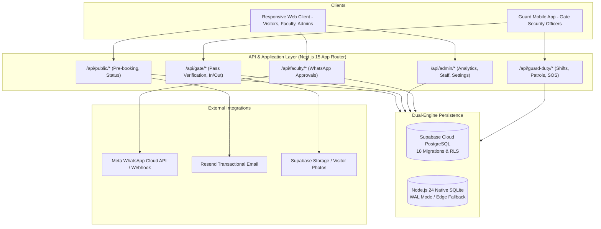
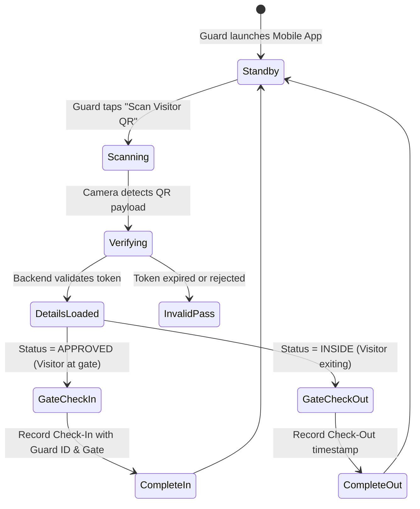

# Campus Security Management System (CSMS)
## System Architecture & Technical Specification

**Target:** Dev Sanskriti Vishwavidyalaya (DSVV), Haridwar  
**Platform Scope:** Responsive Web Portal, Security Desk, Administrator Dashboard, Dedicated Guard Mobile App (Android/iOS)  
**Primary Tech Stack:** Next.js 15.2.0, React 19, TypeScript 5.7, Tailwind CSS, Expo 57, React Native 0.86, Supabase PostgreSQL, SQLite.

---

## 1. Architectural Overview

The system is designed around a unified backend and database core that serves both the responsive web application and the security guard mobile application simultaneously.

---

## 2. Frontend Architecture (Next.js 15 App Router)

### 2.1 Public Visitor Portal (`app/(public)/`)
- **Landing Page (`/`):** Campus entrance guidelines, visiting rules, active department directory, and emergency helpline cards.
- **Booking Wizard (`/pre-book-visit`):** 4-section responsive stepper:
  - *Section A:* Primary visitor personal details, mobile validation, ID verification.
  - *Section B:* Host faculty selection, department lookup, visit date/time slot picker with IST validation.
  - *Section C:* Accompanying visitors, vehicle registration, and purpose explanation.
  - *Section D:* Live facial photo capture via HTML5 `MediaStream` with fallback file upload.
- **Pass Display (`/visitor/pass/[id]`):** Generates QR code using `qrcode.react` with cryptographic pass token.

### 2.2 Administrator Portal (`app/admin/`)
- Protected by `AdminShell` enforcing `ADMIN_ROLES` (`super_admin`, `admin`).
- Real-time KPI statistics: Total visitors today, currently inside campus, checked out today, pending faculty approvals.
- Full visitor registry with live text search, date filtering, and status categorization.
- Export engines: Date-wise CSV and printable PDF reports with formula sanitization.
- Security guard roster, shift schedule dialogs, and registration approvals.

---

## 3. Dedicated Guard Mobile App Architecture (`mobile/`)

### 3.1 Mobile Tech Stack
- **Framework:** React Native 0.86.3 with Expo 57.0.28.
- **Navigation:** Expo Router (file-based stack navigation).
- **Camera Subsystem:** `expo-camera` (`CameraView`) configured for high-speed hardware QR decoding.
- **State & Offline Storage:** `expo-file-system` and local caching in `storage.ts`.
- **UI Components:** Customized `security-ui.tsx` with high-contrast elements, touch-friendly hit areas, and accessible feedback dialogs.

### 3.2 Gate Verification State Machine

---

## 4. Backend & API Services

### 4.1 Route Handlers & Security Wrappers
All API endpoints in `app/api/` utilize hardened higher-order wrappers in `lib/server/http.ts`:
- `authedRoute`: Verifies the `csms_session` cookie or Bearer token, enforces allowed roles, and injects the authenticated `session` context.
- `mutationRoute`: Wraps POST/PUT/DELETE operations in database transactions with standardized error handling (`toApiError`).

### 4.2 Gate Verification Service (`lib/server/services/gate.ts`)
- `verifyPass(tokenOrId)`: Validates the cryptographic token or booking ID, ensures the visit date matches IST today or permitted future window, and returns the visitor's profile, photograph, and current status.
- `gateCheckIn(bookingId, gate, guardId)`: Atomically transitions visitor status to `inside`, inserts a movement record with direction `IN`, and logs guard details.
- `gateCheckOut(bookingId, gate, guardId)`: Atomically transitions visitor status to `completed`, inserts movement record with direction `OUT`, and updates departure timestamps.

---

## 5. Dual Database Architecture

### 5.1 SQLite (Local / Edge)
- Built on Node.js 24 `node:sqlite`.
- Stores data in `.data/campus-security.db`.
- Configured with `PRAGMA journal_mode = WAL`, `PRAGMA foreign_keys = ON`, and `PRAGMA synchronous = NORMAL`.
- Concurrency handled through `BEGIN IMMEDIATE` transactions with serialized queue locking (`withSqliteLock`).

### 5.2 PostgreSQL (Supabase Cloud / Vercel Production)
- Database connection managed via connection pooling (`pg.Pool`).
- Automated parameter transformation (`?` to `$1, $2, ...`) in `lib/server/db.ts`.
- 18 version-controlled migrations with Row Level Security (RLS) enforcing strict tenant and role isolation.
- Dual-write synchronization in `lib/server/supabase-db.ts` keeps cloud and local data in sync.

---

## 6. Cryptography & Security Blueprint

1. **Aadhaar Protection:** Encrypted at rest using AES-256-GCM with PBKDF2 derived keys and random 12-byte IVs. An HMAC-SHA256 digest is maintained for duplicate detection without decrypting the data.
2. **QR Code Integrity:** QR codes do not embed visitor PII. Instead, they store opaque nonces or secure URLs (`/visitor/pass/[id]`). Pass tokens are validated using SHA-256 hash digests.
3. **Faculty WhatsApp Tokens:** One-time URLs carry a 32-byte cryptographically secure random token that expires after 24 hours. Once used, the token is invalidated to prevent replay attacks.
