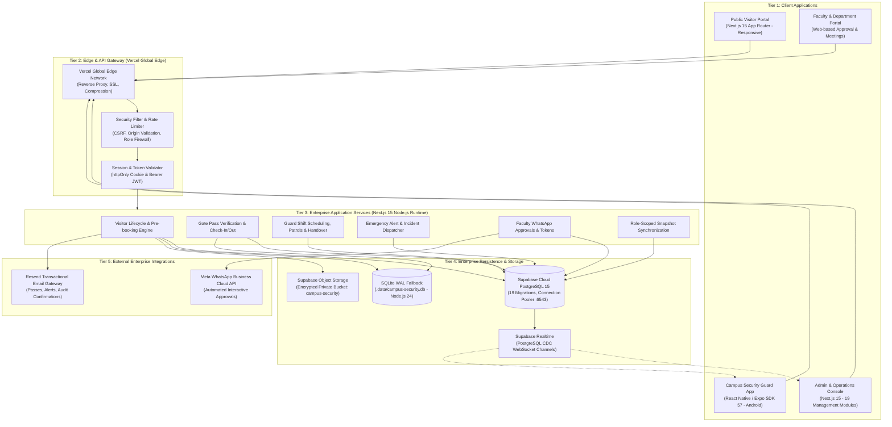

# Campus Security Management System (CSMS)
## Master Enterprise System Architecture

**Institution:** Dev Sanskriti Vishwavidyalaya (DSVV), Haridwar, Uttarakhand  
**Document Version:** 2.0 (Enterprise Edition)  
**Status:** Approved Architectural Baseline  

---

### 1. High-Level System Architecture

The Campus Security Management System operates as a single integrated ecosystem connecting external visitors, university administrators, faculty hosts, and gate security personnel in real time.

---

### 2. Tier Breakdown & Technology Stack

| Tier | Component | Technology / Framework | Function & Specifications |
|---|---|---|---|
| **Tier 1** | Public Web Portal | Next.js 15.2.0, React 19, Tailwind CSS | Multi-step visitor pre-booking, live camera capture, booking status lookup. |
| **Tier 1** | Admin Operations Console | Next.js 15, Radix UI, Lucide, Recharts | Comprehensive monitoring, visitor approvals, guard rosters, gate logs, exports. |
| **Tier 1** | Security Guard Mobile App | React Native 0.86.3, Expo 57, Expo Router | Hardware QR scanning, walk-in check-in, check-out, live stats, emergency SOS. |
| **Tier 2** | Edge & API Gateway | Vercel Edge Runtime & Node.js Serverless | Route distribution, SSL termination, HTTP-only cookie exchange, CORS enforcement. |
| **Tier 3** | Application Business Logic | TypeScript 5.7, Zod 4.6.1 | Transactional state machines, cryptographic token hashing, IST slot calculations. |
| **Tier 4** | Primary Database | Supabase PostgreSQL 15, Supavisor Pooler | ACID relational database, 19 migrations, Row Level Security (RLS). |
| **Tier 4** | Local Edge Storage | Node.js 24 Native SQLite (`DatabaseSync`) | High-concurrency local WAL engine for zero-network edge fallback. |
| **Tier 4** | Object Storage | Supabase Storage (`campus-security` bucket) | Staff-only private bucket for visitor facial photos and incident evidence. |
| **Tier 5** | Messaging & Alerts | Meta WhatsApp Cloud API, Resend | Bi-directional interactive faculty approvals and visitor pass distribution. |

---

### 3. Core Enterprise Design Principles

1. **Strict Zero-Trust QR Verification:** QR codes encode opaque identifiers or cryptographically generated SHA-256 nonces. No Personally Identifiable Information (PII) is stored in QR payloads. All gate clearance decisions are calculated dynamically by the server.
2. **Unified Data Model with Dual-Driver Adapter:** The application employs a unified database abstraction (`lib/server/db.ts`). When deployed on Vercel or when `DATABASE_DRIVER=postgres` is set, queries route through pooled PostgreSQL. Local development and offline desks use native Node.js SQLite with identical schemas.
3. **Role-Scoped Server Snapshots:** The system replaces fragmented micro-queries with centralized role-scoped snapshots (`lib/server/services/snapshot.ts`). Security guards only receive data relevant to their assigned gate, faculty see only their meetings, and visitors cannot view others' records.
4. **Idempotent Mutation Pipeline:** Every gate operation (check-in, check-out, walk-in booking) enforces idempotency keys and state-machine transitions to prevent race conditions or duplicate check-ins.
5. **Campus-Local (IST) Time Horizon:** All time slots, gate opening/closing hours, and duty shifts are calculated in Asia/Kolkata (+05:30) timezone, preventing UTC date-boundary bugs.
