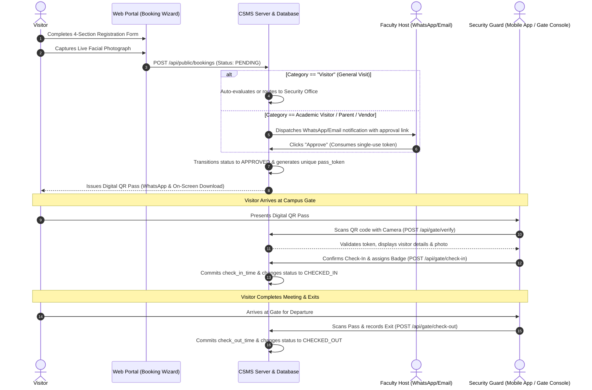

# Campus Security Management System (CSMS)
## Visitor Management & Gate Operations Lifecycle

**Institution:** Dev Sanskriti Vishwavidyalaya (DSVV), Haridwar  
**Workflow Module:** Visitor Pre-Booking, QR Verification, Gate Check-In & Check-Out  
**Implementation:** `components/visitor/booking-wizard.tsx`, `lib/server/services/visitor.ts`, `app/api/gate/*`

---

## 1. End-to-End Visitor Lifecycle Overview



---

## 2. Visitor Registration Form Specification

The visitor registration form operates as an intuitive, 4-section progressive wizard (`components/visitor/booking-wizard.tsx`).

> [!NOTE]
> The current system has streamlined the visitor registration process: legacy scheduling questionnaires and unnecessary "Campus Visit Details" fields have been removed in favor of a clean, security-focused 4-section layout.

### Section A: Visitor Details
* **Full Name (`fullName`):** Mandatory. Minimum 3 characters; valid letters and spaces.
* **Mobile Number (`mobile`):** Mandatory. 10-digit Indian mobile number (must start with 6, 7, 8, or 9).
* **Number of Additional People (`additionalVisitors`):** Mandatory numeric field.
  * **Default value:** `0`.
  * **Helper text:** *"Enter 0 if you are visiting alone. Otherwise, enter the number of people accompanying you."*
  * **Validation:** Non-negative whole integers only (`0, 1, 2, ...`).
* **Email Address (`email`):** Optional. Validated for standard RFC 5322 format when provided.
* **Purpose Category (`purposeCategory`):** Dropdown selection (`Official Meeting`, `Academic Discussion`, `Campus Tour`, `Admission Enquiry`, `Family Visit`, `Event / Seminar`, `Other`).
* **Purpose Description (`purposeDescription`):** Text description detailing the exact objective of the visit.
* **Visitor Category (`visitorCategory`):** Dropdown selector featuring:
  * `Visitor` (General Visitor)
  * `Academic Visitor`
  * `Parent / Guardian`
  * `Official / Vendor`
  * `Alumni`
  * `Other` (opens mandatory text field `otherCategory`)
* **Dynamic Conditional Faculty / Host Field:**
  * **When `Visitor` is selected:** The **Meeting Faculty / Host** dropdown is **completely hidden from the UI**, any previously selected host is cleared, and host validation is disabled.
  * **When `Academic Visitor`, `Parent`, or other categories are selected:** The **Meeting Faculty / Host (`hostId`)** field is displayed with a searchable department directory, enforcing mandatory selection.
* **Specific Person to Meet (`specificPerson`):** Optional text field for the specific staff or official's name.

### Section B: Visit Schedule
* **Visit Date (`visitDate`):** Scheduled date (`YYYY-MM-DD`). Validated to ensure the date is today or in the future within the campus booking calendar.
* **Expected Arrival Time (`visitTime`):** Arrival time slot (`HH:MM`). Validated against active campus visiting hours (07:00 to 19:00 IST).
* **Expected Departure Time (`departureTime`):** Expected departure (`HH:MM`). Validated to ensure departure occurs strictly after arrival.

### Section C: Security Information
* **Visitor Facial Photograph (`photo`):** Mandatory. Captured live via the device webcam or uploaded from camera roll. Stored in the private `campus-security` storage bucket and rendered during gate verification for positive physical identity matching.
* **Vehicle Bringing? (`vehicleRequired`):** Toggle option (`"yes"` or `"no"`).
  * If `"no"`: Visitor is marked as pedestrian.
  * If `"yes"`: Dynamically renders:
    * **Vehicle Type (`vehicleType`):** Dropdown (`Car`, `Two Wheeler`, `Bus`, `Goods Vehicle`, `Other`).
    * **Vehicle Registration Number (`vehicleNumber`):** Mandatory. Auto-converted to uppercase; validated against standard Indian regional transport authority formats (e.g., `UK07AB1234`).

### Section D: Campus Regulations & Consent
* **Declaration Checkbox (`consent`):** Explicit user consent agreeing to abide by university code of conduct, campus traffic speed limits (20 km/h), and security inspection at entry gates.

---

## 3. Cryptographic QR Pass Generation

Once a visit request is approved (either automatically for eligible general visitors or by an authorized faculty member):
1. **Pass Token Generation:** The server generates a 32-character cryptographically secure, URL-safe random string (`pass_token`) using `node:crypto.randomBytes()`.
2. **Zero PII in QR Payload:** To safeguard visitor privacy against eavesdropping, the QR code payload contains **only** an opaque verification URL:
   ```
   https://campus-security.dsvv.ac.in/visit/verify/Cot_Ju8g0FvrGNNJ4H-H2qoS2CpE6q9W
   ```
   *No names, phone numbers, vehicle details, or Aadhaar references exist in the QR matrix.*
3. **Pass Delivery:** The generated digital pass is dispatched to the visitor's mobile number via WhatsApp Business API and rendered in-browser for immediate printing or PDF download.

---

## 4. Faculty Approval Workflow (WhatsApp & Email)

When an academic or department visit is booked:
1. **Notification Dispatch:** An automated notification is sent to the faculty member's registered WhatsApp number containing the visitor's name, purpose, arrival time, and headcount.
2. **Single-Use Action Links:** The notification includes two secure, time-sensitive action buttons:
   * **Approve:** `https://campus-security.dsvv.ac.in/faculty/decision?token={crypto_token}&action=ACCEPT`
   * **Reject:** `https://campus-security.dsvv.ac.in/faculty/decision?token={crypto_token}&action=REJECT`
3. **Replay & Tamper Prevention:** Tokens are stored as SHA-256 hashes in `approval_tokens`. When clicked:
   * The token hash is verified.
   * If already consumed (`consumed_at IS NOT NULL`) or expired (> 24 hours), the action is rejected.
   * If valid, the visit status transitions to `APPROVED`, generating the QR pass immediately.

---

## 5. Security Guard Gate Verification & Entry/Exit Rules

### 5.1 Verification at Gate (`/api/gate/verify`)
1. Guard scans the visitor's digital pass using the Android mobile camera or gate console scanner.
2. The scanner extracts the token and calls `POST /api/gate/verify`.
3. The server resolves the token against `visit_requests`:
   * Verifies visit date is **today**.
   * Verifies visit status is `APPROVED`.
   * Displays visitor's photo, registered vehicle number, accompanying party count, and host details.

### 5.2 Check-In (IN) Procedure (`/api/gate/check-in`)
* Guard verifies physical visitor matches the on-screen facial photograph.
* Guard assigns a physical visitor badge (e.g., `B-104`).
* Guard submits check-in:
  * Server commits `check_in_time = now()`.
  * Status updates to `CHECKED_IN`.
  * Inserts immutable audit row into `check_logs` with `direction = 'IN'`.
* **Duplicate Scan Prevention:** If a pass is already checked in, re-scanning displays a prominent alert: *"Pass is already checked in. Cannot record duplicate entry."*

### 5.3 Check-Out (OUT) Procedure (`/api/gate/check-out`)
* When visitor departs through any campus gate, the guard scans the pass again.
* Server validates that the visitor has an active `CHECKED_IN` record.
* Guard collects physical visitor badge.
* Guard confirms exit:
  * Server commits `check_out_time = now()`.
  * Status updates to `CHECKED_OUT`.
  * Inserts immutable audit row into `check_logs` with `direction = 'OUT'`.
* **Expired / Closed Pass Protection:** Once checked out, the pass is retired. Attempting to scan a checked-out pass displays: *"Pass has already concluded its visit and is closed."*
